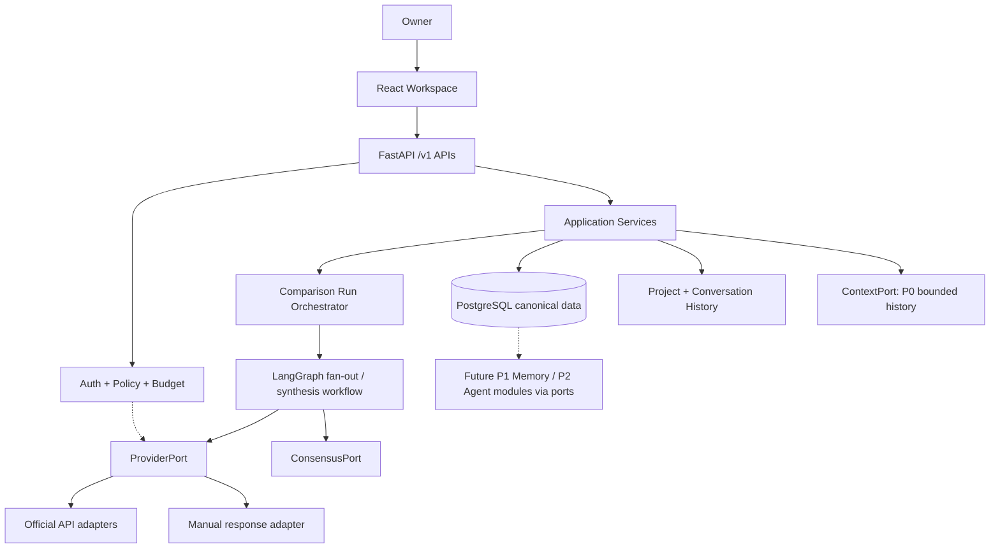
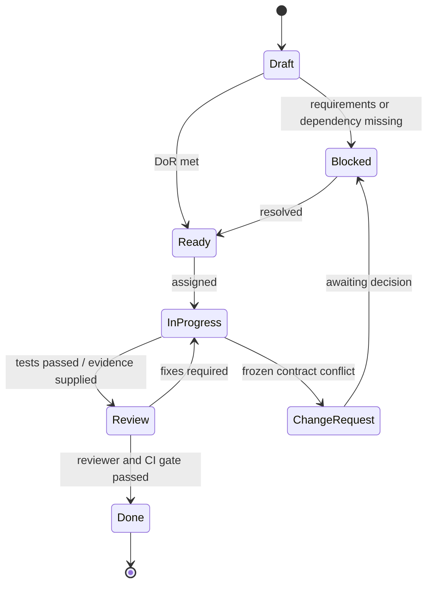

# Personal AI Decision Hub — Design Freeze, Development Governance and Implementation Blueprint

**Document ID:** ADH-GOV-002  
**Version:** 2.0 (proposed; not yet frozen)  
**Date:** 2026-11-08  
**Language:** English  
**Purpose:** Third companion document to the existing Requirements & Architecture Design v1.2, Multi-Agent Research v1.3, and Implementation Roadmap v1.4. It turns prior research into an executable design-review, freeze, task, test, and release process.

## 1. Executive decision

Adopt a **design-first, two-model development workflow**:

1. A high-reasoning Codex run performs architecture review, source reconciliation, requirement traceability, security/threat review, finalized contracts, P0 scope rebaseline, implementation task decomposition and adversarial review.
2. The owner approves the P0 baseline and essential design decisions. Tag the baseline in Git.
3. Use an efficient coding-capable model for bounded, independently testable tasks under the frozen contracts.
4. CI provides objective quality gates. Higher-reasoning review is used selectively for hard defects, security, system integration and change requests.
5. Freeze controls **architecture interfaces and behavior**, not every internal implementation detail; refactoring within a port is allowed if contracts, tests and invariants remain unchanged.

**Product core:** Ask once -> independent model calls and/or manual import -> preserve unmodified outputs -> analyze agreements, disagreements, uncertainty and evidence -> owner makes the decision.

**Do not start with a Chief of Staff or 60-Agent organization.** Plan those as additive P2 capabilities without obstructing P0.

## 2. Input documents and reconciliation rule

| Existing source | Role | Potential inconsistency to resolve |
|---|---|---|
| v1.2 English Requirements & Architecture | Domain concepts, API design, memory provenance, architecture | Several advanced long-term memory functions are marked P0; current business priority says P1 |
| v1.3 Multi-Agent Organization Research | Future agent/skill hierarchy, security and governance | P2 design shall not create P0 implementation obligations |
| v1.4 Research & Implementation Roadmap | M0–M9 sequence, framework findings, future work | M3–M9 are not prerequisites for P0 multi-model comparison |
| This governance v2.0 | Scope precedence, freeze policy, workflow, tests, task rules | Proposed until review and owner approval |

Codex must produce `docs/requirements/traceability.md`, `docs/requirements/conflict-log.md`, `docs/adr/`, updated P0/P1/P2 categorization, and a release version of all frozen contracts before production coding. Conflicts must be explicitly resolved, not overwritten silently. A v1.2 reference to P0 does not automatically outrank the new owner-confirmed priority.

## 3. Business outcomes and release scope

### P0 — Core Decision Hub (first usable release)

**P0 functional scope**

- A single authenticated owner can create/select a project and conversation, enter a question and choose 2+ distinct model targets (including a manual target).
- The system can send independently prepared first-round requests concurrently through permitted APIs, as limits allow; it can accept pasted responses from already subscribed chat applications.
- Every response captures original text, provenance status, provider, actual model ID if known, status, elapsed time, cost/usage when available, and links to its initiating run.
- Users can inspect every response independently and view an explicit comparison: agreements, differences, uncertainties, source/support quality and a conditional recommendation. The comparison must not manufacture consensus or citations.
- Project/conversation/run history persists across restart and can be reopened. Basic P0 context may consist of manually selected conversation history or a bounded current-project summary; do not require automatic long-term memory extraction.
- Safe failure behavior: partial results, deadline, cancellation, errors, idempotent run submission, per-run budget/quota preflight and per-provider disable controls.
- Basic login/authentication, owner/project access control, secrets management, immutable audit events for consequential operations, export/backup/restore and a working local Docker Compose deployment.
- Minimal model registry stores model family and resolved ID; unknown or dynamically routed identities stay labeled rather than guessed.

**P0 non-goals**

- Autonomous browser simulation of consumer chat logins; unlimited use of paid chat subscriptions as developer API access.
- Fully automatic memory extraction/curation, graph memory, hybrid vector search, fact verification via web research, advanced selective routing, extended branching debates, scheduled execution.
- Chief of Staff, research teams, Agent Factory, tool permissions/approval for external writes, remote-agent federation, A2A or MCP implementation.
- Cloud migration as a prerequisite for the local MVP; remote access is an optional separately gated enhancement.

### P1 — continuity and decision intelligence

Cross-session **retrieval** beyond simple history; typed Core/Episodic/Semantic/Project/Decision memory; memory candidates and owner review; retrieval provenance; optional Mem0 adapter; vector indexing; curator; advanced evidence verification; selective routing; structured decision supersession and context-manifest viewer. P1 may implement only proven-useful features after P0 evaluation.

### P2 — agent organization

Chief of Staff; durable task ledger; versioned Agent/Skill Registry; hierarchical subgraphs; Agent Factory with human approval; sandboxed coding agents; scheduled jobs and optional A2A/MCP. Agent roles are logical definitions, not permanent servers. Human approval and non-LLM policy enforcement are compulsory for consequential external actions.

### P0 rebaseline mapping

| v1.2 requirements | v2.0 proposed disposition | Note |
|---|---|---|
| FR-001–FR-007 | P0 | Primary user journey, raw results and persistent conversation |
| FR-008 | Split P0/P1 | P0: reopen/search basic same-project history; P1: semantic cross-session retrieval |
| FR-009–FR-011 | P1 | Rich six-category memory and automatic candidates are not P0 release blockers; reserve MemoryPort |
| FR-012 | Split P0/P1 | P0: save owner decision and rationale; P1: complete supersession history, alternatives and memory integration |
| FR-013 | Split P0/P1 | P0: minimal privacy-scoped outbound request/context record; P1: advanced context retrieval and rich manifest |
| FR-014–FR-018 | P0 | Failures, cost/registry, export, security baseline |
| FR-019–FR-027 | P1 | As in original with P0 contracts reserved if clearly needed |
| FR-028 onward | P2 unless explicit feature reclassification | Future multi-agent and background operations |

**This table is a proposal, not a signed change to v1.2.** Codex must map *every* original requirement ID to an approved release, acceptance test and owner, then submit discrepancies for the G1 gate.

## 4. Architectural design baseline

### 4.1 P0 logical architecture



### 4.2 Architecture invariants

1. Canonical data remains ours and survives provider/framework replacement.
2. `Run -> ModelResponse -> Claim/Comparison` is immutable evidence, with append-only corrections or versioning.
3. First-round provider answers are independent; failure of one target does not erase others.
4. Separate provider identity from app branding and from gateway identity; dynamic routing is recorded.
5. Domain/app services call ports; SDK-specific details are isolated in adapters.
6. Auth, outbound context policy, redaction and hard budget preflight precede external calls.
7. LangGraph checkpoints represent recoverable workflow state, not canonical user memory.
8. All external interfaces are versioned and tested; migrations follow expand/backfill/switch/contract.
9. P1/P2 hooks are explicit **interfaces / events**, not empty deployed microservices or invented capabilities.
10. The UI never hides failed/incomplete answers and never claims hallucinated evidence is verified.

### 4.3 Component ownership

| Component | Owns | Must not own |
|---|---|---|
| Workspace/UI | Input, target selection, progress, original/report visualization | Business truth or direct API keys |
| Identity & Policy | Authentication, project access, context filtering, budget gates | LLM narrative decisions |
| Conversation Service | Projects, threads, raw messages, history | Provider SDK transport |
| Run Service | Run lifecycle, idempotency, fan-out status, cancellation | Canonical long-term memory extraction |
| Provider Gateway | Configurable adapters, identity, response/usage normalization | Claims promoted to facts |
| Consensus Service | Evidence-labeled comparative synthesis, uncertainty | Owner decision or external fact verification claim |
| Decision Service (P0 slim) | Owner decision, optional explanation, link to run | Auto-accept model recommendation |
| Persistence/Operations | PostgreSQL, migrations, backup/restore, health, logs | UI business rules |
| P1 Memory Adapter (reserved) | Future scoped retrieval/extraction | Ownership of conversation history |
| P2 Agent Adapter (reserved) | Future task/agent orchestration | Bypassing domain policy |

### 4.4 Minimal P0 data and contract boundaries

**Canonical tables:** `users`, `projects`, `conversations`, `messages`, `runs`, `run_targets`, `model_responses`, `comparisons`, `provider_models`, `usage_events`, `owner_decisions`, `audit_events`, `outbound_context_snapshots`. Add `schema_version`/`created_at` consistently. Model and gateway IDs must be version-aware. Keep migrations reversible or documented as forward-only with verified restoration.

**Public /v1 API minimum** (final shapes specified in OpenAPI at G1):
- `POST /v1/projects`, `GET /v1/projects`, `POST /v1/conversations`, `GET /v1/conversations/{id}/messages`
- `GET /v1/providers` and model/feature capabilities
- `POST /v1/runs` (Idempotency-Key), `GET /v1/runs/{id}`, `GET /v1/runs/{id}/responses`, `GET /v1/runs/{id}/report`
- `POST /v1/runs/{id}/manual-responses`, `GET /v1/runs/{id}/events` (SSE or documented polling fallback)
- `POST /v1/decisions`, `GET /v1/decisions/{id}`, `GET /v1/usage`, export/backup controls if exposed in UI

**Internal ports:** `ProviderPort`, `ConsensusPort`, `ConversationRepository`, `RunRepository`, `PolicyPort`, `BudgetPort`, `ContextPort`, `ExportPort`. Reserve `MemoryPort` and `AgentPort` with narrow interfaces; do not instantiate P1/P2 behavior in P0.

**Run state machine:** `queued -> running -> awaiting_manual? -> synthesizing -> completed | completed_partial | failed | cancelled`. Document manual wait deadline, retry policy, partial results, resynthesis after late manual responses, and version of published report. Runs must be idempotent on repeated submission. Do not claim exactly-once network delivery; achieve replay safety through idempotency plus deduplication.

## 5. Design freeze policy

| Gate | Decision / artefacts | Authority | Exit evidence |
|---|---|---|---|
| G0 — Review | Read all three sources; requirement conflicts; ADR alternatives; technical spikes; provisional design | Codex high reasoning | Gap report + signed-off recommendations |
| G1 — Freeze | P0 scope, requirements trace, ports, schema, OpenAPI, workflows, UI states, tests, backlog | Owner approves business scope; Codex validates technical consistency | Git-tagged baseline, approved ADRs, no unresolved P0 blocking issues |
| G2 — Task complete | Bounded code delivered, tests, docs, coverage links | Coding agent + CI | All task acceptance criteria met |
| G3 — Integration | Cross-component regression, migrations, mock providers, auth/privacy/cost | CI + independent review | Milestone test report and passing build |
| G4 — P0 release | End-to-end scenario, failure handling, security, restore, rollback | Owner acceptance + verified artifacts | Release candidate tagged and runnable |

**Freeze scope:** public API, domain invariants, data ownership, integration seams, requirement identifiers and acceptance gates. **Not frozen:** variable names, private function internals, tuning parameters, code formatting, implementation details that preserve contracts, additive tests and bug fixes.

**Exception CR process:** record `CR-ID`, trigger, affected baseline IDs, security/data impact, alternatives, compatibility strategy, migrations, new/changed tests, reviewer recommendation and owner decision. Categories: (a) emergency security or data-loss repair; (b) critical architecture contract issue; (c) planned later-version enhancement. No unapproved breaking contract changes during P0; pause affected work only. Audit CRs in Git.

## 6. Codex working model: design once, code in bounded batches

**Design review session:** Use selected highest-capability model, generally Astra High; Extra High only for genuinely difficult reconciliation. Have one reviewer synthesize a complete baseline and a separate adversarial session challenge it. Do not confuse more reasoning tokens with better evidence.

**Coding sessions:** Prefer efficient available coding models (e.g., GPT-5.6 Sol / GPT-6.1 Sol). One independent task per run, referencing baseline commit + task ID; limit file scope; tests built before or along with implementation. Do not paste every entire architecture document into every task if files are already present in repo.

**Usage management:** check Codex usage dashboard and model picker; shared usage does not reset when switching models. Reduce context, avoid long exploratory branches, use CI and deterministic tests for repetitive checks; reserve Astra for architecture exceptions, complex integration defects and security review.

### 6.1 Coding task format

```yaml
id: TASK-XXX
milestone: P0-M1
baseline: ADH-v2.0@<git-tag-or-sha>
requirements: [FR-002, FR-016]
status: ready # draft | blocked | ready | in_progress | review | done
scope: [exact behavior to implement]
out_of_scope: [explicit exclusions]
inputs: [schemas, contracts, prerequisite tasks, fixtures]
dependencies: [TASK-YYY]
deliverables: [code paths, migrations, tests, documentation]
acceptance: [observable pass/fail criteria]
constraints: [ports, safety, compatibility, budget]
test_plan: [unit, contract, integration, regression, negative]
integration_impact: [other modules and events affected]
rollback: [rollback or safe remediation plan]
review_evidence: [commands, CI run URLs, artifacts]
```

**DoR (definition of ready):** baseline ID known, requirements traced, inputs available, acceptance measurable, dependencies merged, API/schema decisions frozen. **DoD (definition of done):** code+tests+migration+doc update (as applicable), CI pass, security/cost checks, no unresolved contract violation, evidence logged, integration owner notified.

### 6.2 Task execution states



### 6.3 Integration cadence and tests

| Level | Trigger | Key checks |
|---|---|---|
| Unit | Each task/PR | Domain state machines; validators; adapters with fakes; comparison schema; cost logic |
| Contract | Each adapter/API change | OpenAPI payloads; ProviderPort conformance; error schemas; DB schema compatibility |
| Component integration | Each related feature merge | FastAPI + real test PostgreSQL; fake provider; idempotency; state transitions |
| Cross-feature regression | End of each vertical slice | UI -> API -> provider -> storage -> comparison -> reopening run |
| Security/negative | Every integration milestone | Unauthenticated access; cross-project leakage; secrets; malicious model output; budget rejection |
| Deployment | M1 baseline and release candidates | `docker compose up`, migration on fresh DB, restart, health, export+restore |
| Acceptance / E2E | Release G4 | 2+ independent providers/manual input, partial failure, original response view, owner decision, persistence |

CI cannot guarantee live third-party API availability. Use deterministic mock provider adapters and fake responses for reliable regression; run limited real-provider smoke tests on demand. Store test results as traceable evidence against requirement IDs. Aim for 100% coverage of P0 requirements by tests, not necessarily 100% line coverage.

**Integration rule:** do not leave integration until the end. Merge and test a thin vertical slice after each feature cluster. Keep a release branch stable and use feature flags for incomplete code when necessary. Break glass only for documented security or data-integrity defects.

## 7. Implementation milestone plan

Map existing v1.4 M0–M9 into a **P0-first track**. Names below are release work packages; later P1/P2 are not P0 blockers.

| Work package | Tasks | Release-gate demo | Dependencies |
|---|---|---|---|
| P0-M0: Design and freeze | Architecture reconciliation; FR mapping; API/schema/workflow design; tests; task cards; ADRs | A fully traceable, approved and tagged P0 plan | Source docs |
| P0-M1: Foundation | Repo scaffold; Postgres/Alembic; auth; CI; observability; Docker | Fresh machine starts API/UI/DB and passes health tests | P0-M0 |
| P0-M2: Input-to-response | Provider registry; provider adapter; manual response import; run persistence; fan-out | Ask once; receive and inspect independent raw answers, tolerate provider failure | P0-M1 |
| P0-M3: Comparison & owner decision | Synthesis schema; comparison workflow; UI; owner decision; usage and privacy | End-to-end question -> multiple answers -> comparison -> owner choice | P0-M2 |
| P0-M4: Hardening and release | Cross-session reopening; backup/restore; quality/security; independent review; deployment doc | 100% P0 requirement tests mapped and pass, publish release | P0-M3 |
| P1: Memory intelligence | Automatic extraction/retrieval, curator, memory explorer, advanced decisions | Existing P0 unchanged, memory feature behind port/flag | P0 release |
| P2: Agent hierarchy | Chief of Staff, Task Ledger, Agent Factory, teams | Existing comparison graph used as callable subgraph | P0, P1 as appropriate |

### 7.1 Ordered P0 implementation tasks (proposed)

| ID | Task | Requirements / dependency | Gate |
|---|---|---|---|
| D-001 | Inventory existing source docs; identify missing artifacts and contradictions | v1.2–v1.4; none | G0 |
| D-002 | Rebaseline FR priorities P0/P1/P2 and write traceability matrix | D-001 | G0 |
| D-003 | ADR review: ports, schema, fan-out, auth, provider transport, privacy/budget | D-002 | G0 |
| D-004 | Freeze OpenAPI, event schemas, DB schema, UI states, E2E cases | D-003 | G1 |
| D-005 | Create dependencies, task cards, test matrix and baseline tag proposal | D-004 | G1 |
| C-001 | Scaffold backend/frontend/repository structure and local config | D-005 | G2 |
| C-002 | Compose PostgreSQL + Alembic + test DB migrations | C-001 | G2 |
| C-003 | Owner auth, project scoping and baseline secret policy | C-002 | G2 |
| C-004 | CI: lint, typecheck, tests, fake providers and contract checks | C-001 | G2 |
| C-005 | Project/conversation/message persistence and CRUD API | C-002,C-003 | G3 |
| C-006 | Model registry with resolved model identity and capabilities | C-002 | G3 |
| C-007 | ProviderPort + one documented API provider adapter | C-006,C-004 | G3 |
| C-008 | Manual-import provider adapter with declared identity | C-005,C-006 | G3 |
| C-009 | Run state machine, fan-out, timeout, partial failure, cancellation | C-005,C-007,C-008 | G3 |
| C-010 | Usage ledger, budget preflight, idempotency and privacy context | C-009,C-003 | G3 |
| C-011 | ConsensusPort, structured comparison output and uncertainty labels | C-009 | G3 |
| C-012 | UI: ask, choose models, view raw answers, comparison and errors | C-005,C-009,C-011 | G3 |
| C-013 | Save/reopen owner decisions and conversation history | C-011,C-012 | G3 |
| C-014 | E2E regression and negative/security tests; all acceptance mappings | C-010–C-013 | G4 |
| C-015 | Backup/restore, fresh install test, release notes and rollback rehearsal | C-014 | G4 |

Design tasks D-001–D-005 can be prepared/validated in Codex with a higher-reasoning model. Coding tasks C-001–C-015 are candidates for more economical models; split any task that does not fit comfortably within one isolated change.

## 8. Review and traceability requirements

For every original and new requirement, capture: ID, description, authoritative source, final priority, design components, API endpoints, data objects, work items, positive and negative tests, status, unresolved risks. No P0 row may be `unmapped` when G1 closes.

**Independent design review must answer:**
- Do the three source documents contradict the new P0-first priority?
- Can the entire initial user workflow be demonstrated with no paid subscriptions other than user-authorized API calls (or fully manual import)?
- Are actual model identities and limits captured, rather than deduced from product names?
- Are messages and raw responses preserved independently of LangGraph?
- Are privacy and budget limits enforceable before any provider dispatch?
- Can P1 memory and P2 agents attach without changing canonical P0 data contracts?
- Are P0 APIs, persistence, UI states, error transitions and test cases complete enough for a small coding model?
- Are any cross-project data leaks, silent retries, double billing or fabricated citations possible?
- Are backup, restore, rollback and schema compatibility demonstrable?

**G1 approval evidence:** requirement-coverage summary, unresolved issue count = 0 for blockers, passing contract/schema validation, approved architecture diagrams and ADRs, task dependency DAG without cycles, and a signed baseline commit/tag. Record accepted risks; don't assume all low-priority research has been completed.

## 9. Risk register and escalation triggers

| Risk | Mitigation | Trigger for high-reasoning review |
|---|---|---|
| P0 overdesign / scope creep | Freeze P0 acceptance; P1/P2 interface only | Task touches P1/P2 feature internals |
| Provider unavailable, paid or model silently changed | Registry, fallback/manual import, identity snapshot | Provider results cannot be verified |
| Uncontrolled usage | Preflight and usage ledger; hard ceilings | Billing unknown, retries or cost overruns |
| Bad comparison misrepresented as fact | Raw responses + provenance + non-verification labels | Unsupported high-impact claims in report |
| Framework storage coupling | Canonical domain schema; ports | LangGraph internals appear in domain entities |
| Cloud capacity/VM cost surprise | Build local Docker first; test ARM64; no forced cloud commitment | Cloud cannot fit budget or safe deployment |
| P1 memory contaminating P0 | Stub interfaces + no automatic persistence of claims as facts | Memory writes become implicit in P0 comparison |
| Changed requirements during freeze | Formal CR and additive changes | Any breaking API/data/ownership change |

## 10. Handoff package structure and operational instructions

```text
repo/
  AGENTS.md
  docs/
    IMPLEMENTATION_GOVERNANCE_AND_DESIGN_BASELINE_v2.0.md
    CODEX_FINAL_DESIGN_REVIEW_PROMPT.md
    requirements/
      traceability.md
      conflict-log.md
    adr/
    architecture/
      baseline-v2.0.md
      diagrams/  # Mermaid source
    api/openapi.yaml
    testing/test-matrix.md
    test-reports/
  tasks/
    TASK_TEMPLATE.md
    P0_DELIVERY_BACKLOG.md
    TASK-*.md
  apps/web/
  services/api/
  packages/contracts/
  infra/docker/
  tests/{unit,contract,integration,e2e}/
```

**What to provide to Codex:** three existing documents, this governance package, and the repo state. First use the design-review prompt and a high-reasoning model to reconcile and freeze. After owner approval, implement only approved work tickets with the selected coding model. Use separate, small runs; read repo files instead of pasting redundant full documents.

**Success criterion for this third document:** The owner can tell Codex "review and freeze P0, generate tasks, then implement approved tasks using the repo instructions," and Codex has clear authority boundaries, pass/fail tests, change controls and a staged integration strategy.
