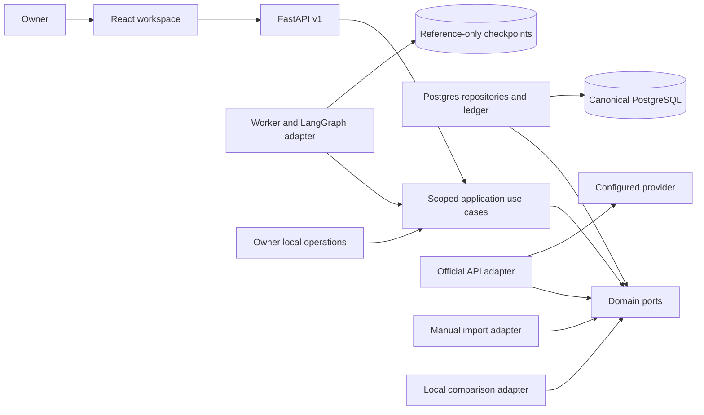
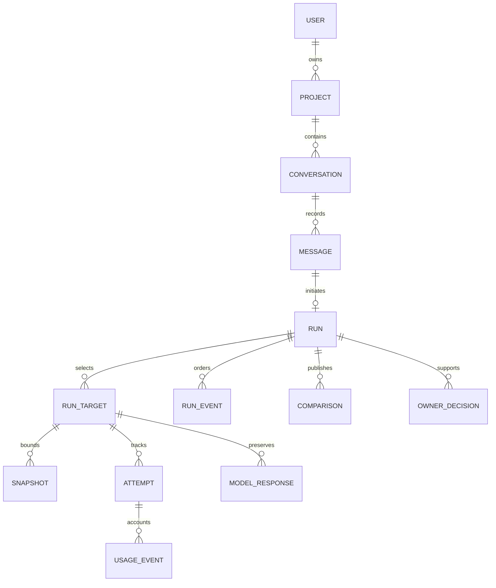

# Personal AI Decision Hub · owner design review

Decision requested: approve a local, single-owner workspace that takes one question, collects independent answers, preserves their originals, compares the evidence, and records the owner's choice. The first useful workflow accepts pasted answers. Gemini is the first candidate for a qualified live adapter. Approval sets a zero paid-spend ceiling. Rich memory follows in P1. A multi-agent platform follows in P2.

## Requirements and current evidence

A project owns conversations, runs and decisions. Reopening a project must restore its original evidence. The owner selects context, can inspect what was eligible for each recipient, and controls every recorded decision. A model family can contribute multiple answers, but only attributable distinct families count as independent confirmations. A partial result must identify every missing target. The owner can run offline, move their data, restore it, and change their architecture through a reviewed change request. The matrix retains 30 functional, 16 non-functional and 15 multi-agent requirements, including phase splits and negative cases. [Complete requirement matrix](requirements/traceability.md)

| Decision reviewed on November 9, 2026 | Published evidence | Project commitment and verification |
|---|---|---|
| Fixed comparison workflow for P0 | Anthropic describes parallel independent work and aggregation as a workflow used in practice. [Engineering guidance](https://www.anthropic.com/engineering/building-effective-agents) | Use a bounded fan-out and collect originals before synthesis. Delay one fake provider and confirm sibling answers never enter its request. Add delegation only after the basic flow earns its place. |
| Durable execution and replay | LangGraph documents thread-scoped checkpoints and recovery. PostgreSQL documents queue-consumer row locking with SKIP LOCKED. [LangGraph persistence](https://docs.langchain.com/oss/python/langgraph/persistence) · [PostgreSQL locking](https://www.postgresql.org/docs/16/sql-select.html) | PostgreSQL owns evidence and reservations. Checkpoint IDs allow resumption. C-009 must kill a worker on either side of a send, reject stale writes and preserve uncertain liabilities. Queue-row skipping is unsuitable for calculating the total spend. |
| Gemini eligibility, privacy and quota | Google describes project-level quotas and Pacific daily resets. Its terms distinguish paid and unpaid services and address data use. Billing reporting can lag. [Rate limits](https://ai.google.dev/gemini-api/docs/rate-limits) · [Terms](https://ai.google.dev/gemini-api/terms) · [Billing](https://ai.google.dev/gemini-api/docs/billing) | C-007 records the actual project's tier, model, effective terms, region and limits. C-010 enforces both the owner's UTC budget and the provider's applicable quota window. Test two keys on one project and the interval between UTC and Pacific midnight. Use synthetic inputs for live qualification. Deny personal/confidential content for a tier whose terms disallow it. |
| Comparison quality and evidence | MT-Bench researchers observed position and verbosity biases in model judges. Their benchmark evaluates model judging; it does not validate this application's comparator. [Original study](https://arxiv.org/abs/2306.05685) | P0 uses local evidence-linked comparison and can abstain. C-011 must pass the six controlled examples and repeat the opposition and minority examples with response order reversed. A failure to detect explicit negation blocks release. [Acceptance examples](testing/comparison-fixtures.md) |
| Backup portability | PostgreSQL documents logical dump archives and restoration to other installations. [PostgreSQL backup documentation](https://www.postgresql.org/docs/16/app-pgdump.html) | C-015 separately tests a clean portable content import and an encrypted operational restore. Verify sessions are invalidated, data survives restart and egress stays disabled during recovery. |

The cited techniques have implementations and documented behavior. The exact Gemini entitlement, semantic quality on the owner's questions and long-term recovery performance require project-specific evidence. No external model or judge is activated by approval.

## Full architecture

### 1. First usable release

An authenticated owner selects a project and conversation, asks once, chooses two or more distinct registry targets, and receives independent API answers, manually pastes originals, or combines both. The owner sees every requested slot, its original or reason for absence, the evidence-aware report and a separate action to record a decision. A later session can find the question by project-scoped text search and open the same evidence and choice. An offline comparison can use two different manual slots. Verified independent family count may be zero. A legacy one-manual-target request collects an original with an explicit insufficient-comparison label.

P0 delivers this workflow in local Compose with bounded context, cost controls, export/import, encrypted backup and recovery. P1 owns rich memory, semantic retrieval, source verification and decision revisions. P2 owns task/agent organization, external tools, schedules and optional remote protocols. See ADR-201 and the phase rows in traceability.

### 2. Components and contracts

The browser holds no provider key. The API and worker share domain contracts and transaction rules. The worker owns graph execution, claim leases and fenced writes. Checkpoints contain IDs, revisions and stage only. The application can recover using canonical rows and ordered events after loss of a checkpoint. Repositories constrain every path by authenticated owner and current project, including search, polling, originals, snapshots, reports, decisions and exports. The same owner may have two projects with different authorized sources.

| Port | Input and result | Failure/ownership rule |
|---|---|---|
| AuthorizationPort | Principal, action, resource and project → allow/deny and policy version | Sole policy decision point. “PolicyPort” in governance names this responsibility. Deny on missing scope. Hide foreign object existence. |
| ConversationRepository | Owner/project, conversation, stable message sequence and source IDs → scoped records or page | Insert question atomically with run. Stable UTC timestamps, cursors bound to scope, immutable message bytes and ordered history. |
| RunRepository | Admission or expected run revision, fenced attempt and event → committed aggregate/version | Owns target lifecycle, exact idempotent replay and terminal guard. Make transition, event and relevant evidence one transaction. |
| ContextPort | Owner, project, question, explicitly selected earlier sources and provider policy → bounded projection plus snapshot ID | Filter by ACL and recipient before selection/truncation. Deny if essential question cannot be released. Never use a sibling's first-round answer. |
| BudgetPort | Owner, target, capped input/output, tariff, quota, deadline and idempotency identity → reservation or reason | Atomic run/day/month check and ordered reconciliation. Quota unknown or price without enforceable upper bound rejects admission. |
| ProviderPort | Capabilities/estimate and frozen generation request with attempt ID, timeout, allowed model and bound → original or classified failure plus available identity/usage | No adapter may send without a valid permission and reservation. Map provider errors locally. Manual adapter accepts user-declared input and has no outbound transport. |
| ConsensusPort | Immutable run, successful originals, exact input IDs, context metadata, outcomes and version → validated comparison | Runs locally. Must abstain on unsupported relationships, retain minority evidence and identify absences. Never writes an owner decision. |
| ExportPort | Owner/project, versioned format → portable archive, or validated import into empty destination | Strip secrets and operational data. Preserve content, hashes and scope-linked evidence. |
| Reserved interfaces | MemoryPort: scoped query/review with source IDs. TaskPort: bounded request/status by project. AgentRegistryPort: versioned capability lookup. RemoteAgentPort: dispatch/status with explicit permission and budgets. | Design seams only. Future modules use existing use cases/events. No P0 memory table, agent registry, team process or tool endpoint is implied. |

Domain objects never import SQL, vendor SDK or LangGraph types. When keys or provider capabilities change, the registry and adapters absorb the change. P0 uses PostgreSQL without requiring pgvector on greenfield bootstrap. Existing prototype databases may contain the extension.

### 3. Canonical records and invariants

All IDs are stable. Store UTC timestamps, schema versions, scoped foreign keys and unique business identities in PostgreSQL. Record money in exact USD units with conservative upward rounding on reservations. Use null for unknown measured values. A prototype wire field with a required unknown sentinel keeps that sentinel for compatibility. A blank or zero never stands for unavailable usage.

| Aggregate | Canonical records and essential constraints |
|---|---|
| Identity/history | users, revocable hashed sessions, projects(owner), conversations(project), immutable messages(conversation, sequence, content, digest). Unique sequence per conversation. Derive owner from authenticated session. Composite keys or equivalent constraint triggers enforce same-project message, conversation and run links. |
| Request and targets | runs(owner, project, conversation, question message, request key/fingerprint, revision, state, deadline); run_targets(run, registry selection, frozen identity, acquisition, state). Unique owner/request key and run/slot. Store normalized request alongside its fingerprint. Identical replay returns original run after scope check; changed input with same key returns conflict. Preserve old request fingerprints and equality rules for old keys. |
| Registry and originals | provider_models holds declared app, provider, gateway, alias, model family, routing mode, eligibility and tariff/policy version. Each dispatch pins the requested configuration. model_responses keeps raw text, digest, source target/attempt, actual reported identity and confidence, source, times and inclusion. Preserve whitespace and Unicode. Uniquely associate accepted manual paste with its target and deduplicate receipt by attempt. Keep separate late receipts excluded from aggregation. |
| Context | outbound_context_snapshots identifies target/attempt, project, selected source IDs/versions, omission/redaction decisions, policy version, limits, digest of serialized permitted input and timestamps. Store only enough to reconstruct/audit approved projection. No secret, denied content or full request body in audit, events or checkpoints. Mark owner-supplied manual context as unobserved. |
| Work, accounting and events | Durable run work/lease (unique run, worker fencing token, expiry), attempt identity and receipt, usage_events, reservation and settlement identity, run events with unique monotonically increasing sequence per run, immutable audit_events with actor, action, outcome, time and trace. A grant or spend decision is durable before transport. Guard against stale worker updates. |
| Comparison | comparisons(run, version, input response IDs, coverage, algorithm/version, findings, evidence, limitations). Unique run/version. Claims have stable IDs and resolvable same-run source spans. Store as normalized records or immutable typed report children with referential validation before publication. |
| Owner choice | owner_decisions(owner/project/run, stable ID, explicit choice, optional rationale, source references, timestamp). Require at least one scoped source and an explicit owner submission. Restrict keys across projects. No generated choice, implicit revision or automatic fact adoption. |

### 4. Admission, context and spend

1. Validate authenticated owner, project/conversation, unique target slots and bounded request shape. Check an existing idempotency key before charging or acquiring work. Require same project in every explicit source. Inaccessible IDs receive the same not-found response as unknown IDs.
2. Default context to the question. The owner may select bounded prior messages by stable ID within the same project. Freeze the round's source set and per-target candidate projections at admission. Dispatch-time policy may only remove content or block the request. Impose configured input, output and deadline limits, redact according to each recipient's permission, and report differences. A restricted or unknown recipient fails closed. Never imply the hub observed an external chat's actual prompt.
3. Verify registry enablement, official recipient, verified entitlement, non-expired price/limits, enforceable input/output maximum, and no paid fallback. Calculate a conservative upper bound including full input, max output and all potentially billable provider features. Disable unbounded features. Check min(requested run limit, owner run/day/month ceilings) and applicable request/token quotas. Default paid ceiling is zero. Manual targets incur zero hub charges and do not rely on developer access. Reject whole submission before external work for invalid selection, forbidden egress or unsafe aggregate budget. API specifies the status codes.
4. In one transaction, hold the aggregate upper bound, persist message/run/targets, create initial work/event and return accepted. Lock owner/account-period ledgers consistently across concurrent runs. Charge admission against current UTC day/month, then atomically revalidate or move the undelivered reservation to the actual dispatch period before sending. Do not release the old hold unless the new window admits it. Carry unresolved prior liability conservatively across boundaries until billing can be attributed; never reset an unresolved exposure at midnight.
5. Worker leases work, reloads cancellation/deadline, permission, registry and price, freezes exact permitted request and durably records the fenced attempt before transport. If eligibility changes, block the affected target, release only proven-unsent reservations and continue eligible siblings. Respect configured concurrency; parallel branches never depend on sibling output. A disable or cancellation blocks future sends, with best-effort interruption of already started calls.
6. No transaction spans the network. A crash before proven send permits safe resumption. A crash after committed send intent with ambiguous delivery holds maximum cost and never blindly sends again. A retry requires proof of non-delivery or the provider's documented idempotency guarantee covering the entire retry window, same payload/key and reserved bounds. Attempt count, deadline and aggregate quota remain bounded. On confirmed completion reconcile known usage. If actual billing remains unknown, retain the hold. On excess billing disable the adapter and escalate. No retries or external judge are necessary for a manual comparison.

### Execution, adoption and qualification

Use the [transaction and lifecycle contract](api/lifecycle.md), [migration and recovery contract](api/adoption.md), [test matrix](testing/test-matrix.md) and [comparison quality examples](testing/comparison-fixtures.md). Prototype conformance and provider activation require separate evidence.

## API and durable execution

The [OpenAPI contract](api/openapi.yaml) specifies each endpoint, shape and error. The [domain schemas](api/domain.schema.json) define internal records.

Use the run row lock, expected revision and worker fence for every transition. Write state, monotonic event sequence, raw receipt or report and accounting intent in the same transaction as applicable. A poll reads committed events. On simultaneous commands the first valid transaction wins. Check the deadline under lock. Existing identical idempotent requests can replay their recorded result after a deadline. Fresh manual submissions at or after it fail. Each table row is a parameterized contract test for each listed source/destination. Test every other ordered state pair for rejection with zero changes. A retry of an identical command returns the existing result without another event.

| Case | From | To | Trigger and expected observation |
|---|---|---|---|
| S01 | absent | queued | Commit admission, reservations, question and work together |
| S02 | queued | running | Fenced worker claims work |
| S03 | queued | cancelled | Owner cancels before dispatch |
| S04 | queued | failed | Deadline with zero accepted originals |
| S05 | running | awaiting_manual | Only pending manual slots remain |
| S06 | running | synthesizing | At least one original available and all slots settled or deadline reached |
| S07 | running | failed | No usable original after all slots settle |
| S08 | running | cancelled | Owner wins cancellation lock |
| S09 | awaiting_manual | synthesizing | Last import or deadline, at least one original |
| S10 | awaiting_manual | failed | Deadline with zero originals |
| S11 | awaiting_manual | cancelled | Owner cancels |
| S12 | synthesizing | completed | Publish version 1 with all targets successful |
| S13 | synthesizing | completed_partial | Publish version 1 with missing or unsuccessful targets |
| S14 | synthesizing | failed | Bounded synthesis recovery exhausted; originals remain readable |
| S15 | synthesizing | cancelled | Cancellation wins before atomic publication |

| Case | From | To | Trigger |
|---|---|---|---|
| T01 | absent | pending | Register API target |
| T02 | absent | awaiting_manual | Register manual target |
| T03 | pending | in_flight | Commit attempt and bounded reservation before transport |
| T04 | pending | blocked | Policy, budget or eligibility changed |
| T05 | pending | timed_out | Deadline before send |
| T06 | pending | cancelled | Cancel before send |
| T07 | in_flight | succeeded | Persist original and settle known usage |
| T08 | in_flight | failed | Definitive failure |
| T09 | in_flight | delivery_unknown | Ambiguous send, timeout or worker crash; preserve hold |
| T10 | in_flight | timed_out | Definitively expired attempt; reconcile only verified billing |
| T11 | in_flight | cancelled | Best-effort interruption; retain any uncertain liability |
| T12 | awaiting_manual | succeeded | Atomic exact-text import for selected target |
| T13 | awaiting_manual | timed_out | Deadline settles slot |
| T14 | awaiting_manual | cancelled | Owner cancels |

Close admission to new receipts when entering synthesis. Persist late API evidence with its excluded disposition and reconcile known charges even after terminal state. A new comparison after the deadline is a new run and key. Publication references an immutable set of input IDs. Terminal runs retain the original report. Resume synthesis from these IDs. Retrying a safe transport attempt creates a fenced attempt under the same target with the same immutable approved bytes and valid reservation. No automatic retry follows ambiguous delivery.

On deadline, lock the run and settle every open target before freezing input IDs. Pending and awaiting_manual expire to timed_out. In-flight attempts with uncertain delivery settle to delivery_unknown and retain their holds. A queued run with an already imported answer advances via S02 without dispatch, then S06 under the same lock. For safe bounded retries the target stays in_flight while new attempt records are appended. Commit T08 only when a definitive failure ends all retries. On cancellation settle every open target as cancelled and preserve outstanding liabilities. Late receipts cannot change terminal states.

The prototype at f3c0677 uses /v1. Keep its login, scoped project, conversation, history, provider, run and original-response paths. Preserve legacy arrays, UUIDs, question hashes and target bindings. New fields are additive. Expose the durable run state alongside the legacy status field. Preserve single-manual selection for collecting an original. A normal comparison asks for two or more distinct targets. Use polling for progress.

Expand schema before enabling writers. Backfill each legacy run under a lock from its original IDs, timestamps, deadline and target rows. Preserve old idempotency fingerprints and check old keys before computing a new request fingerprint. For settled legacy runs without a report, queue local synthesis when originals exist. Recovered manual records never create external work. Validate a populated 0002 fixture and replay prior keys with legacy clients before switching reads. Quiesce workers before rollback and restore into an isolated database. Invalidate sessions, apply erasure records, reconcile uncertain spend and verify original hashes before enabling outbound calls.

Portable project archives contain scoped content, source links and schema versions. Exclude credentials, session tokens, password hashes, raw checkpoints and provider secrets. Stage imports, validate hashes and references, then commit atomically. Require an empty destination. A repeated import into a populated destination fails before any write. Operational recovery uses a separate encrypted backup and recovery key. Annual or release rehearsal alone cannot demonstrate a daily backup cadence.

Legacy run status projects queued, running and synthesizing to running; awaiting_manual to awaiting_manual; completed to complete; completed_partial to partial_complete; failed and cancelled to failed. Legacy target status projects pending to pending; in_flight to running; awaiting_manual to awaiting_manual; succeeded to complete; blocked, timed_out, cancelled, failed and delivery_unknown to missing. Clients use state and error_code to distinguish causes.

## All P0 implementation tasks in delivery order

| Task and implementation card | Depends on | Deliverable and completion check |
|---|---|---|
| [C-001 · Reproduce the local workspace](../tasks/TASK-C-001.md) | — | New checkout plus synthetic credentials serves the web shell and readiness endpoint through loopback. Missing bootstrap configuration fails with a redacted actionable error. |
| [C-002 · Migrate canonical PostgreSQL storage](../tasks/TASK-C-002.md) | C-001 | Upgrade both an empty DB and a populated f3c0677 fixture twice. Observe stable UUIDs, unchanged source text and hashes, rejected orphan references and rejected evidence mutations. |
| [C-003 · Enforce owner authentication and access scope](../tasks/TASK-C-003.md) | C-002 | Valid owner can log in and revoke the session. Expired/replayed cookies, cross-origin writes and guessed foreign UUIDs fail. Inputs, password, cookie and keys are absent from logs and export. |
| [C-004 · Install reproducible verification gates](../tasks/TASK-C-004.md) | C-001 | Run without provider secrets. A seeded timeout and identity mismatch are reproducible. Introduce an incompatible response in a fixture and confirm contract validation fails. |
| [C-005 · Persist projects, conversations and bounded history](../tasks/TASK-C-005.md) | C-002, C-003, C-004 | Two concurrent messages get distinct ordered IDs. Reopening a session returns original text. Foreign project, malformed cursor and stale references are rejected. |
| [C-006 · Register targets and snapshot identity](../tasks/TASK-C-006.md) | C-002, C-004 | Two aliases resolving to the same family count once. Unknown dynamic identities are visibly unknown. Editing the catalog does not relabel a prior result. |
| [C-010 · Guard outbound context, replay and spend](../tasks/TASK-C-010.md) | C-003, C-004, C-005, C-006 | Race requests at the last budget unit and observe at most one eligible dispatch. Unknown maximum price, absent consent or denied source prevents network I/O. Same key plus changed payload conflicts. |
| [C-008 · Import a manual original](../tasks/TASK-C-008.md) | C-005, C-006 | Concurrent identical imports return a single stable response ID; changed payload conflicts. Wrong owner, target or elapsed deadline cannot amend a published original. |
| [C-007 · Qualify one official Gemini adapter](../tasks/TASK-C-007.md) | C-004, C-006, C-010 | Fake transport exercises timeout, disabled/unverified target, rate limit and identity mismatch. A separately authorized non-sensitive live fixture returns a traceable original within approved ceilings before real-provider acceptance. |
| [C-009 · Orchestrate independent durable runs](../tasks/TASK-C-009.md) | C-005, C-007, C-008, C-010 | Three-target fixture delivers completed, timeout and pending manual entries independently. Kill worker before and after external dispatch. Restart never resends ambiguous billable requests. Every terminal state and transition has a test. |
| [C-011 · Compare attributable original evidence](../tasks/TASK-C-011.md) | C-009 | For same-family copies, unknown identities, a minority position and a missing response, show coverage without added votes. Every proposition has a valid source span; insufficient support yields abstention. |
| [C-012 · Ship the browser comparison workflow](../tasks/TASK-C-012.md) | C-005, C-009, C-011 | Browser reload during a partial run returns same run and answers. Keyboard-only navigation reaches every target and source. Auth loss and failed imports give accessible feedback without losing saved originals. |
| [C-013 · Record the owner's decision and resume it](../tasks/TASK-C-013.md) | C-005, C-011, C-012 | Recording a decision twice with the same key creates one record. A changed body or foreign source fails. Reading a recommendation alone never creates a decision. |
| [C-014 · Run cross-component adversity and compatibility suite](../tasks/TASK-C-014.md) | C-003, C-004, C-009, C-010, C-011, C-012, C-013 | Attach CI/commit, timings, redacted failing examples and outcome for each P0 row. Unexpected outbound content, duplicate billable attempt or a missing trace fails G3. |
| [C-015 · Export, restore and rehearse a local release](../tasks/TASK-C-015.md) | C-013, C-014 | Corrupt export, foreign reference, missing recovery key and an existing restore destination fail safely. Restored instance reproduces UUIDs, originals, report and decision through the browser. |

## Milestone acceptance

1. Foundation qualifies the local boot, migrations, owner isolation and offline CI. Keep the prototype as a migration fixture. Adopt components only when their card passes.
2. Protected input and Slice A establish exact original storage, permission filtering and reservations. Manual import can finish while Gemini qualification is pending. Simulated transport lets development continue. A real mixed-provider release demonstration requires separately authorized evidence.
3. Slice B exercises a three-target run with a timeout, shows original and missing answers, and verifies comparison sources from the browser after reload.
4. Slice C verifies the owner's recorded choice and evidence from a later session. Repeat attempts, privacy denials and interrupted runs against PostgreSQL with a deterministic transport.
5. Slice D demonstrates portable export/import, encrypted restore and rollback. Record measured RPO/RTO, platform builds, latency and CI revision before requesting G4 approval.

At each task, record its frozen revision, run scoped unit and contract cases, then save the observed outcomes. At each milestone, rerun the previous working slice and the new cross-component tests. Implementation exceptions identify the failing case, affected contracts and migration path before changing scope. [24 P0 case families](testing/test-matrix.md) · [Task specifications](../tasks/README.md)

## Later releases

P1 adds reviewed memory candidates, versioned memory, retrieval with source provenance, decisions that supersede prior choices, and evaluation of multilingual recall. P2 starts with the task ledger, then a small research pilot, versioned agent and skill registries, and a controlled agent factory. Remote tools and federation require separate permission and acceptance decisions. Each later milestone has its own dependencies and evidence. [Full M0–M9 roadmap and 30 engineering steps](handoff/v1.4/AI_Decision_Hub_Multi_Agent_Implementation_Roadmap_v1.4_EN.md) · [Original 49-task plan](requirements/tasks.md)

## Verification before owner approval

On November 9 the OpenAPI validator passed, the domain schema and four audit fixtures passed, and the coverage audit found 61 source requirements, 24 specified P0 cases and 15 acyclic cards. Five prototype PostgreSQL tests passed. A separate Compose stack passed the browser journey through login, manual comparison, import, refresh and logout. The synthetic encrypted restore took one second; project, conversation, run, message and response records matched after restart. This drills a small local fixture. Production-sized recovery, nightly off-host backups, independent live fan-out, billing bounds and comparator quality still require their named release tests.

The prototype runtime snapshot had stale response definitions on the same 16 paths. The review refreshed contracts/openapi.json from the built test image; docs/api/openapi.yaml remains the proposed target. No product feature changed during this review.
