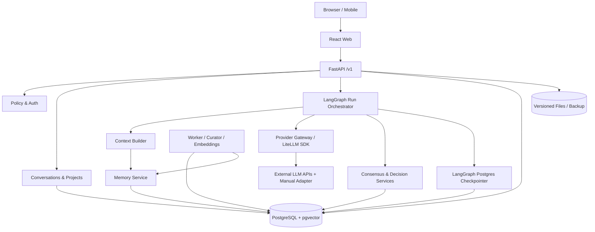
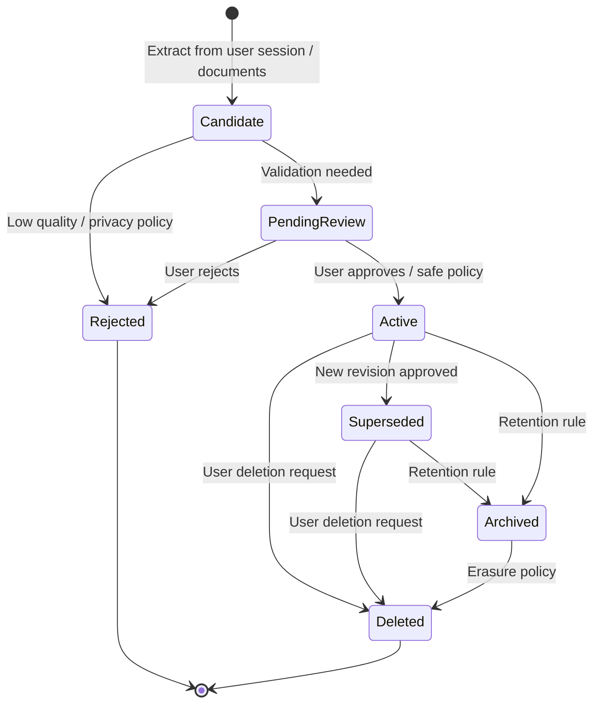
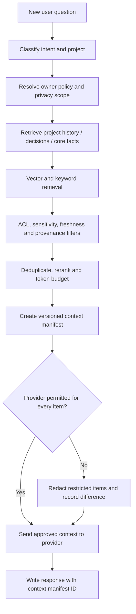
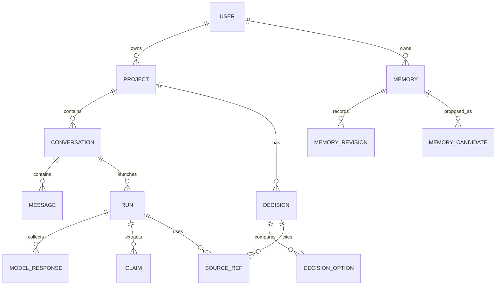
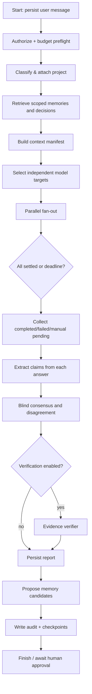
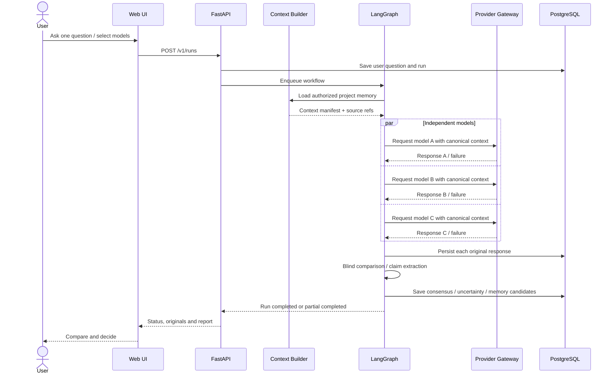
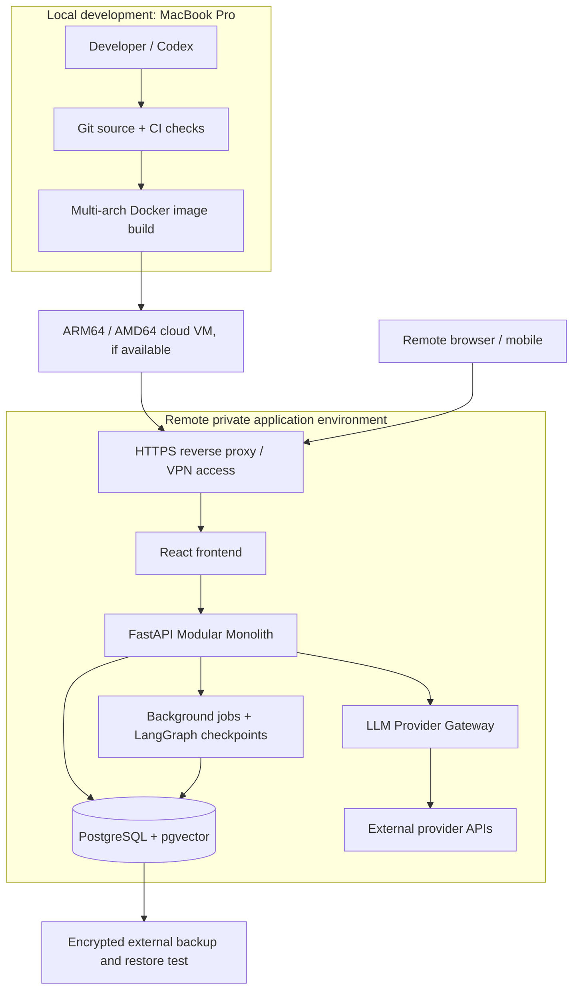
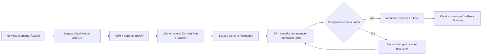

# Personal AI Decision Hub
## Consolidated Requirements, Research Findings, and Solution Architecture

**Document ID:** PAIDH-SAD-001  
**Version:** 1.2 — English Edition (Proposed Architecture Baseline)  
**Date:** November 8, 2026  
**Status:** Design baseline; no application implementation or cloud/API entitlement is implied  
**Document owner:** Project owner  
**Authoring policy:** All technical design deliverables, diagrams, code comments, and specifications are written in English. Conversations with the owner may use English or Chinese.

> **Document control.** This file is the editable source of truth. The eight Mermaid diagrams are embedded in their relevant sections. The companion Word document renders the same diagrams as figures. Any material change should update requirements, architecture decisions, contracts, tests, and affected diagrams in one pull request.

---

## Executive Summary

The Personal AI Decision Hub is a **memory-first, model-independent personal AI workspace**. It allows its owner to ask a question once, obtain independent responses from selected large language models, compare their agreements and disagreements, inspect original responses and evidence, record a personal decision, and resume the work in another conversation months later.

The system is **not** merely a multi-model answer aggregator. It maintains distinct, persistent records for conversations, claims, memories, projects, decisions, and workflow checkpoints. The application owns the canonical information; model providers and memory-extraction frameworks can be replaced without losing the owner's data.

**Recommended implementation:** React front end, Python/FastAPI modular-monolith back end, PostgreSQL with pgvector, LangGraph for stateful workflow orchestration, a Provider Gateway implemented behind a domain port (initially LiteLLM SDK plus manual response import), and a pluggable Memory Service (initially a native implementation or a Mem0 OSS adapter). Use Docker Compose for local development on a MacBook Pro, then deploy the same container architecture to a suitable low-cost or free-tier Linux VM, subject to actual service availability and terms.

**Non-negotiable design boundaries:**

1. Raw conversations and original model responses are immutable evidence, not automatically verified facts.
2. Memory is a derived, reviewable, versioned projection of source material.
3. A model's assertion is a **claim**; model consensus is not proof of truth.
4. A decision is an explicit user choice with alternatives, rationale, provenance, and change history.
5. Workflow checkpoints are execution data, not the long-term knowledge base.
6. External model calls must respect privacy scopes, model identity, API eligibility, and hard cost limits.
7. New capabilities should be added via stable ports, adapters, new workflows, and additive schema migrations.

### Document Map

| Section | Content |
|---|---|
| 1–2 | Goals, research synthesis, confirmed assumptions |
| 3 | Functional and non-functional requirements |
| 4 | Logical architecture and module boundaries (Figure 1) |
| 5 | Memory design, lifecycle, and retrieval (Figures 2–3) |
| 6 | Canonical data model and schema rules (Figure 4) |
| 7 | REST API and internal contracts |
| 8 | LangGraph workflows and sequence diagram (Figures 5–6) |
| 9–10 | Provider integration, security, and governance |
| 11 | Docker and cloud deployment (Figure 7) |
| 12–14 | Quality strategy, requirements review, and evolution (Figure 8) |
| 15–18 | Roadmap, research backlog, architecture decisions, references |
| Appendices | Repository, configuration, and definition of done |

## 1. Goals, Scope, and Usage Scenarios

### 1.1 Business and user goals

- **One workspace:** Ask questions, switch projects, compare models, and retain history in one browser-based user interface.
- **Independent perspectives:** Dispatch the same approved question/context to multiple distinct model families, preventing cross-model influence during the first answer round.
- **Useful synthesis:** Show agreements, important disagreements, outlier perspectives, assumptions, uncertainties, and verifiable supporting evidence. Preserve every original answer.
- **Cross-session continuity:** Resume any prior project without re-explaining its background. Recover relevant decisions, constraints, conversation excerpts, and outstanding questions.
- **Long-term ownership:** Allow the owner to inspect, correct, delete, export, back up, and move information between cloud hosts and model providers.
- **Affordable use:** Prioritize permitted free API quotas and existing subscription access where technically supported; otherwise use manual import or optional capped paid APIs.
- **Agent extensibility:** Reserve safe pathways for tools, scheduled reviews, browser/connector integrations, and human-in-the-loop execution, without requiring these in the MVP.
- **Future-proof operation:** Prefer modular contracts, tested data migrations, portable deployment, and observable behavior over dependence on any one framework.

### 1.2 Actors and scope

**MVP actor:** One authenticated owner. Future collaborators or family accounts require explicit tenant and authorization design (not assumed in v1).

| Use case | Example | Expected outcome |
|---|---|---|
| UC-01 — Model comparison | “Will AI agents replace traditional ETL tools?” | Independent responses, original text, agreement/disagreement report, uncertainties |
| UC-02 — Cross-session continuation | “Continue our previous Oracle vs. Cloud Run design.” | Relevant project requirements and decisions retrieved with source links |
| UC-03 — Decision revision | “The Oracle VM is unavailable; switch to Cloud Run.” | New decision supersedes old version without destroying past rationale |
| UC-04 — Memory governance | “This stored preference is outdated.” | Owner reviews the source, revises/deletes the memory, and reindexes retrieval |
| UC-05 — Hybrid model access | Gemini API response plus manually pasted Claude answer | Both answers belong to one run, with accurate acquisition metadata |
| UC-06 — Recovery | Containers restart or application is upgraded | Committed history persists, workflow outcome can be recovered, backup is restorable |
| UC-07 — Future personal agent | Track research findings across a project | Controlled tool permissions, approvals, audit events, long-running task state |

### 1.3 Explicit non-goals for MVP

The first release does not include a public multi-user SaaS offering, unconstrained computer-use automation, deployment of a large GPU-based LLM on a free VM, invisible financial or account actions, or reliance on a third-party chat app's private virtual machine as an arbitrary VPS. Browser-login simulation is not a production model integration dependency.

## 2. Research Synthesis and Architectural Implications

This section captures the comparative research and the limits of what is publicly verifiable. Vendor policies and model availability can change and must be rechecked during implementation.

### 2.1 Foundation models versus agent products

The system must compare **underlying model families**, not merely recognizable application names. Useful independent families include OpenAI GPT, Anthropic Claude, Google Gemini, xAI Grok, DeepSeek, Alibaba Qwen, and Mistral. Meta Llama, Kimi, GLM, and other open-weight families are future candidates. A product such as Claude Code, a personal agent, or a model router may wrap or dynamically select one of these models and therefore must not count automatically as an additional independent vote.

Every provider record includes `app_name`, `provider`, `gateway`, `actual_model_id`, `model_family`, `routing_mode`, `last_verified_at`, and `identity_confidence`. If the underlying model is unknown or dynamically routed, label it `unknown` or `multi-model`; do not invent provenance.

**Special research items:** Confirm exact vendor URLs and actual models for names heard as “Instinct,” “Muse,” “Mills,” or “Grokbot.” The confirmed Meta Muse personal-agent product should be evaluated separately for its execution and memory design; its consumer agent interface is not automatically an official general-purpose inference API.

### 2.2 Chat subscriptions versus APIs

A free chat account or paid consumer subscription does **not** generally imply unrestricted API access. The connection modes are:

| Mode | Benefits | Limitations | Recommended phase |
|---|---|---|---|
| Official provider API key | Reliable, asynchronous, measurable, contract-based | Quota, pricing, credential management | MVP |
| Unified API router (for example OpenRouter) | One interface to many hosted models | Provider/model identity and free quota may change | MVP candidate |
| Permitted free developer tier | Low-cost experimentation | Hard caps, availability, model restrictions | MVP candidate |
| Manual response import | Reuses existing chat account where allowed; no automated login | Extra steps and imperfect model identity | MVP |
| Vendor-approved OAuth/delegated access | May leverage eligible subscriptions in supported products | Entitlement is provider-specific and cannot be assumed | Research spike |
| Browser-assisted interaction | Potentially convenient for some sites | Fragile, consent and terms-of-service issues | Separate investigation only |

Potential low-cost options include Google Gemini API free quotas where available, select OpenRouter free models, GroqCloud's supported developer offerings, Mistral, and Cloudflare Workers AI. **Grok by xAI is not GroqCloud.** Current pricing, rate limits, retention, and data-use policies require provider-specific verification and a documented date. The application must never present an unverified service as permanently free.

### 2.3 Meta Muse — product behavior and transferable principles

Public descriptions of Meta Muse discuss a cloud-hosted personal agent, persistent context, an isolated execution environment, and agent-oriented security. The transferable architectural ideas are **persistent agent identity**, **memory continuity**, **task state**, **policy-controlled tools**, and **user approval for consequential actions**. The actual internal memory implementation is not fully disclosed. Its managed Secure VM should not be assumed to provide general Docker hosting, persistent ports, unrestricted shell access, or a free third-party application server.

### 2.4 ChatGPT Memory — synthesis and freshness

Public OpenAI materials describe memory continuity across conversations and updated/synthesized memory rather than simple concatenation of chat transcripts. The transferable ideas are **selective retrieval**, **periodic consolidation**, **freshness correction**, and **user visibility/control**. ChatGPT's product memory is not assumed to expose a generic API that can be directly mounted as our database. An export/import workflow, if needed, requires official support and explicit user authorization.

### 2.5 Letta / MemGPT — stateful agents and core memory

Letta emphasizes persistent stateful agents and editable, limited-size memory blocks. We adopt the **core-block concept**: concise owner preferences, project guardrails, and agent policies pinned in context where appropriate. We also adopt a versioned memory-file/record mindset, but do **not** make a Letta server a mandatory runtime dependency. MemGPT is part of this architectural lineage, not an independent foundation-model family.

### 2.6 Mem0 — automatic memory extraction

Mem0 is a plausible adapter for extraction, deduplication, and retrieval. **Mem0 OSS and Mem0 hosted offerings are not guaranteed feature-equivalent.** Its default embedding/inference dependencies may incur costs; the application must provide a replaceable `MemoryPort` and `EmbeddingPort` so an alternative native extractor or self-hosted embedding service can be substituted.

### 2.7 LangGraph — workflow persistence, not canonical memory

LangGraph supplies checkpointers, per-thread state, long-lived stores, resume capability, and human approval flow primitives. It fits **parallel model calls, retries, checkpointing, and approval gates**. Canonical conversation and decision records remain in our own domain tables; the application must not directly depend on LangGraph internal checkpointer table layouts.

### 2.8 Research outcome

**Adopt a combination rather than a single proprietary memory engine:**

- LangGraph for execution/checkpoints.
- Native memory domain schema with optional Mem0 OSS extraction adapter.
- Letta-inspired editable core blocks.
- ChatGPT-inspired memory consolidation jobs.
- Muse-inspired persistent agent/tool security patterns.
- PostgreSQL/pgvector for owned structured records and search indexes.

## 3. Requirements Catalogue

Priorities: **P0 = first usable release**, **P1 = next release**, **P2 = future extension**. Targets are design acceptance criteria, not claims of delivered behavior.

### 3.1 Functional requirements

| ID | Priority | Requirement | Acceptance condition |
|---|---|---|---|
| FR-001 | P0 | Unified web chat; create and select projects and conversations | Every question binds to stable `project_id` and `conversation_id` |
| FR-002 | P0 | Select multiple models and show actual family/model/version | Registry and resolved model snapshot are retained for each response |
| FR-003 | P0 | Run independent first-round model requests concurrently | A model does not see another model's first answer before its own response |
| FR-004 | P0 | Support official API adapters and manual response import | One API adapter and one manual adapter operate within one run |
| FR-005 | P0 | Preserve full original responses, failures, and progress | Individual responses can be opened; timeout does not hide completed results |
| FR-006 | P0 | Produce structured agreement, disagreement, uncertainty, evidence, recommendation | Report references response/claim IDs; absent evidence is explicitly labeled |
| FR-007 | P0 | Persist original conversations and messages | Reopening a session after restart returns the same messages and IDs |
| FR-008 | P0 | Retrieve relevant history across sessions | New session can cite earlier requirements and decisions in the same project |
| FR-009 | P0 | Keep six memory categories logically distinct | Category-specific scope, retention, and write policies are enforced |
| FR-010 | P0 | Extract reviewable memory candidates | Model-generated speculation never becomes a verified fact automatically |
| FR-011 | P0 | Let owner approve, edit, reject, and delete memory | Actions write versions, provenance, and audit records |
| FR-012 | P0 | Persist decisions with options, rationale, status, and supersession | Revision preserves prior decision and evidence |
| FR-013 | P0 | Build privacy-aware, token-bounded context packages | Context manifest is reviewable and links to exact source versions |
| FR-014 | P0 | Handle failures, deadlines, and partial results | Remaining models complete and report missing/failed members |
| FR-015 | P0 | Track tokens, estimated spend, quotas, and hard budgets | New call is blocked before dispatch if it breaches the configured limit |
| FR-016 | P0 | Maintain provider/model registry and family deduplication | Routing uses data/configuration, not hard-coded UI entries |
| FR-017 | P0 | Export, backup, import, and restore owned data | Restored instance passes referential integrity and history tests |
| FR-018 | P0 | Owner login, secret protection, and audit trail | Unauthorized users cannot access memory; logs never expose keys |
| FR-019 | P1 | Background memory consolidation/curator | Detects duplicates, contradictions, stale facts; reviews high-impact edits |
| FR-020 | P1 | Optional independent fact and evidence verification | Report distinguishes source citation from independent validation |
| FR-021 | P1 | Route selectively by question type, cost, and model family | Rules can choose fewer models without changing run API |
| FR-022 | P1 | Continue, branch, or question one model from prior run | Link to parent run and preserved historical context |
| FR-023 | P1 | Critic, debate, and adversarial review modes | Later rounds are labeled and never conflated with independent first round |
| FR-024 | P1 | Memory Explorer and temporal/conflict views | User can inspect source and historical revisions of a fact |
| FR-025 | P1 | Document and web RAG with citations | Versioned chunks and access rules work via RetrievalPort |
| FR-026 | P1 | Secure remote access | DB and management ports are not publicly exposed |
| FR-027 | P1 | Cross-language semantic/keyword retrieval | Chinese and English queries retrieve matching permitted project history |
| FR-028 | P2 | Scheduled/background activities and notifications | Idempotent job scheduling, retry, permission gates |
| FR-029 | P2 | Browser, code, mail, or connector tools with approvals | All consequential actions require policy check, audit, and consent |
| FR-030 | P2 | Multi-user or shared projects | Explicit tenant/workspace-level authorization, not implicit ownership |

### 3.2 Non-functional requirements

| ID | Quality attribute | Target / validation |
|---|---|---|
| NFR-001 | Portability | Same code builds AMD64 and ARM64 containers; Compose deployment documented |
| NFR-002 | Durability | Committed messages/decisions survive normal container restarts |
| NFR-003 | Recovery | Initial targets: backup RPO ≤ 24 h, tested RTO ≤ 2 h |
| NFR-004 | Cost control | Per-run, daily, monthly budgets and a hard stop; no unbounded fallback |
| NFR-005 | Privacy | Provider-specific outbound permissions; sensitive content minimized/redacted |
| NFR-006 | Authentication | HTTPS remotely, owner access control, secure cookies, CSRF consideration |
| NFR-007 | Observability | Trace/run IDs, stage status, latency, model ID, usage, errors |
| NFR-008 | API compatibility | `/v1` and OpenAPI; additions within v1 are backward compatible |
| NFR-009 | Safe upgrades | Alembic migrations, pre-upgrade backup, rollback/restore procedures |
| NFR-010 | Model replaceability | New provider/model requires no change to core memory or decision schema |
| NFR-011 | Memory quality | Target ≥ 90% recall on curated critical facts; measured, not assumed |
| NFR-012 | Provenance | Every adopted memory and final decision references at least one source |
| NFR-013 | Isolation | Cross-project retrieval respects owner and project ACLs |
| NFR-014 | Responsiveness | Local non-LLM API P95 target < 500 ms; model execution remains async |
| NFR-015 | Usability | Accessible controls; UI can support multiple languages independently of English design docs |
| NFR-016 | Data ownership | Standard-format export includes original conversations, claims, memories, and decisions |

### 3.3 Open constraints and decisions

The owner has confirmed the need for independent model answers, persistent multi-session memory, free/low-cost preference, and Docker-to-cloud portability. PostgreSQL-first, LangGraph, Mem0 adapter, and Oracle as a cloud candidate are **engineering recommendations** rather than irreversible commitments. API access/quotas, exact third-party application identities, and cloud capacity must be validated during implementation spikes.

## 4. Logical Architecture and Component Boundaries

### 4.1 Architecture style

Use a **modular monolith** with domain-oriented Python modules, a web front end, and a separate background worker process. Apply ports-and-adapters boundaries so the domain layer does not import provider SDKs, Mem0, LangGraph checkpointer classes, or database-specific types. Promote a module to a standalone service only if observed operational needs justify it.

### 4.2 Logical architecture — Figure 1



### 4.3 Module ownership and rules

| Module | Owns | Primary interface | Explicitly excludes |
|---|---|---|---|
| Conversation Service | Projects, conversations, immutable messages | `create`, `append_message`, `read_history` | Memory inference |
| Run Orchestrator | Run lifecycle, graph state, retries, checkpoints | `start_run`, `cancel_run`, `resume_run`, `get_status` | Provider SDK specifics |
| Provider Gateway | Registry, adapters, model cost/usage | `generate`, `capabilities`, `estimate_cost` | User memory/decision ownership |
| Context Builder | Authorization-scoped retrieval, ranking, token budget | `build_context`, `get_manifest` | Editing source messages |
| Memory Service | Candidates, memory items, revisions, retrieval policy | `propose`, `review`, `revise`, `search` | Unrestricted external model calls |
| Decision Service | Decision alternatives, rationale, supersession | `commit_decision`, `get_history` | Auto-accepting model advice |
| Consensus Service | Claims and comparative analysis | `extract_claims`, `synthesize` | Promoting claims to verified facts |
| Evidence Service (P1) | Independent source verification | `verify_claims` | Unreviewed long-term memory writes |
| Policy/Security | Identity, permissions, sensitivity, budget checks | `authorize`, `evaluate_outbound` | User content interpretation |
| Persistence/Export | Repositories, migrations, backups, exports | Storage and export ports | Business inference |
| Background Worker | Queued idempotent tasks, memory curation, index rebuild | `enqueue`, `run_job`, `retry` | Separate canonical facts |
| Tool Runner (P2) | Tool isolation and approval enforcement | `request_action` | Silent consequential actions |

**Dependency rule:** `HTTP/API -> Application services -> Domain ports <- Infrastructure adapters`. Domain events have stable IDs and versioned schemas. Providers receive only the context explicitly allowed by the policy service.

## 5. Persistent Memory Architecture

### 5.1 The six memory types

| Type | What is stored | Retrieval pattern | Update / retention |
|---|---|---|---|
| CORE | Stable preferences, important guardrails, assistant role | Small, pinned, token-capped blocks | User-edited or reviewed facts; versioned |
| EPISODIC | Conversation and run evidence, timestamps, key episodes | Timeline plus hybrid semantic search | Original text retained/archived by policy |
| SEMANTIC | Extracted verified/reviewed facts and entities | Structured + keyword + vector retrieval | Candidate -> review -> active; temporal validity |
| PROJECT | Requirements, documents, open decisions, constraints | Project-scoped context search | Versioned with project lifecycle |
| DECISION | Options, chosen path, rationale, evidence, conditions | Structured search plus citations | User approval; supersession without erasure |
| OPERATIONAL | Graph checkpoint state and task metadata | `thread_id` and workflow identifiers | Time-bounded and separate from canonical history |

**Core block examples:** `user_preferences`, `project_constraints`, `privacy_guardrails`, and `assistant_role`. A block is a concise versioned value with scope and source IDs, not an unlimited past-chat transcript.

**Memory curator (P1):** Trigger at a configurable cadence or after sufficient new messages. Suggest merges, conflict resolution, staleness revisions, and deletions. Safe index maintenance may run automatically; sensitive/high-impact semantic changes require review. Retrieval models and embedding providers are separate configurable adapters.

### 5.2 Memory lifecycle — Figure 2



**Lifecycle states:** `candidate -> pending_review -> active -> superseded | archived | deleted`, with `rejected` as a terminal candidate state. A user deletion immediately excludes data from retrieval and prompts physical/index/cache cleanup under the retention policy. Backups may expire on a documented schedule; no claim of instant deletion from every offline backup is made.

**Required memory attributes:** `memory_id`, `owner_id`, `project_id`, `memory_type`, `content`, `source_type`, `status`, `confidence_label`, `sensitivity`, `valid_from`, `valid_to`, `version`, `source_refs`, `created_at`, and `updated_at`.

### 5.3 Retrieval and context policy

1. Authenticate the caller; resolve the current project and provider privacy profile.
2. Classify the request: project, topic, time sensitivity, and history relevance.
3. Retrieve core blocks, current project decisions, recent conversation episodes, and vector/keyword search candidates in parallel.
4. Apply owner/project ACL, sensitivity, freshness, temporal validity, and provenance filters **before** external transmission.
5. Deduplicate and rerank candidates; assemble a token-bounded canonical context with explicit priority: policy -> question -> critical project constraints -> decisions -> verified/reviewed facts -> source excerpts.
6. Create one immutable context manifest listing source IDs, memory versions, redaction decisions, and token counts.
7. Apply per-provider outbound policies. Record any context differences so the comparison report does not claim equal conditions when they differ.
8. Persist the actual context manifest reference on every model response.

### 5.4 Context retrieval — Figure 3



### 5.5 Provenance, trust, and memory pollution controls

- **User-stated preference** and **externally verified fact** use distinct evidence types. Both retain exact source links.
- A model answer becomes a claim with `unverified` status by default. Agreement among models does not upgrade that claim automatically.
- A reviewed memory revision never destroys earlier versions; instead it changes active/superseded status and validity dates.
- Conflicts are explicit relations, not silently overwritten strings. Important contradictory updates are surfaced for review.
- Highly sensitive personal information is excluded from automatic memory extraction by default and cannot be sent to third-party providers without an applicable owner policy.
- Embeddings are rebuildable projections. Each index record stores embedding model/version, dimension, and generation time to support staged replacement.

## 6. Canonical Data Model and Schema

### 6.1 Entity relationship model — Figure 4



### 6.2 Primary entities

| Entity / table | Essential fields and purpose |
|---|---|
| `users` | Stable owner ID, auth reference, account state |
| `projects` | `project_id`, `owner_id`, name, status, visibility, description |
| `conversations` | `conversation_id`, `project_id`, title, created/updated timestamps |
| `messages` | Immutable message ID, sequence, role, content, timestamps, source hash |
| `runs` | Run ID, question/message links, mode, state, deadline, budget, context manifest ID |
| `model_responses` | Provider, requested/resolved model, family, status, raw content, timing, token/cost, attempt |
| `claims` | Exact proposition, model response ID, evidence status, source references |
| `source_refs` | URI, message ID, file/chunk ID, citation span, version, retrieval timestamp |
| `memory_candidates` | Proposed content, candidate kind, source refs, confidence label, review state |
| `memory_items` | Scope, type, active text, sensitivity, validity, status, current revision |
| `memory_revisions` | Versioned changes, prior content, actor, reason, timestamps |
| `decisions` | Decision ID, project, selected option, rationale, status, supersedes ID |
| `decision_options` | Evaluated alternative, assumptions, constraints, tradeoffs |
| `context_manifests` | Source selections, applied redactions, token budget, provider policy snapshot |
| `provider_models` | Provider/gateway, family, resolved ID, capabilities, fee tier, verification date |
| `usage_events` | Request ID, provider/model, token usage, estimated/actual cost, reservation state |
| `audit_events` | Who/what/when, outcome, trace IDs, no embedded secrets |
| `memory_embeddings` | Rebuildable embedding vector and model/version metadata |
| `jobs` | Durable background task, attempts, lock/lease, next run, idempotency |

### 6.3 Physical modeling rules

Use UUID keys, UTC `timestamptz`, explicit foreign keys, sensible unique constraints, and JSONB only for genuinely extensible metadata. Business-critical query fields should remain typed columns. Index owner/project/status/time columns. Keep sensitive content out of database debug logs and unencrypted backups.

PostgreSQL is the canonical datastore; pgvector supports retrieval but is not the source of truth. Use Alembic migrations. LangGraph checkpoints are stored via its supported saver adapter and are not mutated through our domain repositories.

**Minimal illustrative memory schema (conceptual):**

```sql
CREATE TABLE memory_items (
  memory_id UUID PRIMARY KEY,
  owner_id UUID NOT NULL REFERENCES users(user_id),
  project_id UUID NULL REFERENCES projects(project_id),
  memory_type TEXT NOT NULL,
  current_text TEXT NOT NULL,
  status TEXT NOT NULL,
  sensitivity TEXT NOT NULL DEFAULT 'private',
  current_version INTEGER NOT NULL DEFAULT 1,
  valid_from TIMESTAMPTZ NULL,
  valid_to TIMESTAMPTZ NULL,
  created_at TIMESTAMPTZ NOT NULL DEFAULT NOW(),
  updated_at TIMESTAMPTZ NOT NULL DEFAULT NOW()
);
CREATE TABLE memory_revisions (
  revision_id UUID PRIMARY KEY,
  memory_id UUID NOT NULL REFERENCES memory_items(memory_id),
  revision_number INTEGER NOT NULL,
  text TEXT NOT NULL,
  actor_type TEXT NOT NULL,
  reason TEXT NULL,
  created_at TIMESTAMPTZ NOT NULL DEFAULT NOW(),
  UNIQUE(memory_id, revision_number)
);
```

This is a conceptual excerpt, not a complete production migration. The reference schema from v1.0 may be reused as an implementation starting point after review; all executable migrations must be kept under version control.

## 7. API and Internal Interface Contracts

### 7.1 REST conventions

Use `/v1`, OpenAPI 3.1, JSON payloads, UTC ISO 8601 timestamps, cursor pagination, and machine-readable errors using `application/problem+json`. Support `Idempotency-Key` on side-effecting run/approval/decision requests. Use revision numbers and `ETag`/`If-Match` where concurrent edits may conflict. Long model execution is asynchronous; UI subscribes to server-sent events (SSE) or polls status rather than holding a request open.

| HTTP method and path | Purpose | Principal response |
|---|---|---|
| `POST /v1/projects` | Create project | Project ID and metadata |
| `GET /v1/projects/{id}` | Read project | Project details and policy |
| `POST /v1/conversations` | Start a conversation | Conversation ID |
| `GET /v1/conversations/{id}/messages` | Paginated history | Messages and next cursor |
| `POST /v1/runs` | Start model comparison | `202 Accepted`, run ID, status URL |
| `GET /v1/runs/{id}` | Run lifecycle and per-model status | State, usage, errors, report availability |
| `GET /v1/runs/{id}/events` | SSE progress | Stage transitions and event IDs |
| `POST /v1/runs/{id}/manual-responses` | Add a pasted answer | Response ID and declared provenance |
| `GET /v1/runs/{id}/responses` | Read raw results | Response objects and provider metadata |
| `GET /v1/runs/{id}/report` | Read consolidated analysis | Agreements, disagreements, claims, evidence |
| `GET /v1/context-manifests/{id}` | Review outbound context | Allowed items, omissions, provider differences |
| `GET /v1/memories` | Search scoped memory | Items, versions, source links |
| `POST /v1/memory-candidates/{id}/approve` | Accept candidate | New memory/revision ID |
| `POST /v1/memory-candidates/{id}/reject` | Reject candidate | Updated candidate state |
| `PATCH /v1/memories/{id}` | Versioned edit | New version and conflict status |
| `DELETE /v1/memories/{id}` | Remove from retrieval and queue cleanup | Tombstone and purge job ID |
| `POST /v1/decisions` | Record owner decision | Decision ID, version, status |
| `GET /v1/decisions/{id}` | Read decision and history | Alternatives, rationale, source references |
| `GET /v1/providers` | Available models/tiers | Capability and identity metadata |
| `GET /v1/usage` | Cost/budget status | Estimated/actual totals and limits |
| `POST /v1/exports` | Generate portable export | Job ID and scope |

### 7.2 Example run request and accepted response

```http
POST /v1/runs
Idempotency-Key: b0a52161-2f6c-4f6f-a179-d3d5a0000001
Content-Type: application/json
```

```json
{
  "conversation_id": "7396b3a8-ff2f-4a59-8e7b-f5187b3dffdb",
  "question": "Will AI agents replace conventional ETL in five years?",
  "model_targets": [
    {"provider": "google", "model_id": "registry:gemini-default"},
    {"provider": "openrouter", "model_id": "registry:independent-model"},
    {"provider": "manual", "model_id": "user-specified-claude"}
  ],
  "analysis_mode": "deep",
  "memory_policy": "project_scoped",
  "max_total_cost_usd": 0.25
}
```

```json
{
  "run_id": "1e98e7a2-6df9-4637-b605-8b86691d7a73",
  "status": "queued",
  "links": {"status": "/v1/runs/1e98e7a2-6df9-4637-b605-8b86691d7a73"}
}
```

Requested `registry:` aliases resolve to specific models immediately before dispatch, and the resolved identity is saved per response. The manual answer is marked as user-declared identity, not verified API identity.

### 7.3 Consensus response contract

```json
{
  "run_id": "...",
  "status": "partial_complete",
  "coverage": {"requested": 3, "completed": 2, "missing": ["manual:claude"]},
  "agreements": [{"summary": "...", "claim_ids": ["..."]}],
  "disagreements": [{"topic": "...", "positions": [{"model_response_id": "...", "summary": "..."}]}],
  "evidence": [{"claim_id": "...", "grade": "unverified", "source_refs": []}],
  "recommendation": {"text": "...", "assumptions": ["..."]},
  "limitations": ["One manually requested answer has not been supplied"],
  "context_manifest_id": "..."
}
```

Error codes: `400` malformed request; `401/403` authentication or permission; `404` unknown/invisible resource; `409` state or revision conflict; `422` schema failure; `429` hard budget or quota; `503` provider unavailable. All errors include `error_code` and `trace_id`.

### 7.4 Internal domain ports

```python
from typing import Protocol

class ProviderPort(Protocol):
    async def generate(self, request: "GenerationRequest") -> "GenerationResult": ...
    async def capabilities(self, model_id: str) -> "ModelCapabilities": ...
    async def estimate_cost(self, request: "GenerationRequest") -> "CostEstimate": ...

class MemoryPort(Protocol):
    async def propose(self, source_refs: list[str], context: dict) -> list["MemoryCandidate"]: ...
    async def search(self, request: "MemorySearchRequest") -> list["MemoryHit"]: ...
    async def revise(self, command: "MemoryRevisionCommand") -> "MemoryItem": ...

class EmbeddingPort(Protocol):
    async def embed(self, texts: list[str]) -> list[list[float]]: ...

class RetrievalPort(Protocol):
    async def find_context(self, request: "ContextSearchRequest") -> list["SourceExcerpt"]: ...

class ToolPort(Protocol):
    async def request_action(self, command: "ToolActionRequest") -> "ApprovalOrResult": ...
```

Each adapter has contract tests. No vendor-specific payload or enum should leak into core domain types without an explicit mapping.

## 8. LangGraph Workflows and Processing Semantics

### 8.1 Comparison workflow — Figure 5



**Graph state (references preferred):** `run_id`, `conversation_id`, `owner_id`, `project_id`, request, `context_manifest_id`, targets, response IDs, claims, report ID, errors, budget snapshot, pending approvals, status, schema version. Avoid copying full personal histories into checkpoint payloads.

**Run lifecycle:** `queued -> retrieving -> dispatching -> collecting -> analyzing -> complete | partial_complete | failed | canceled`. A manual target may stay `awaiting_manual` while other targets finish. Explicitly define a completion deadline, so one absent manual answer cannot block a report indefinitely.

**Reliability:** Persist the run before network calls. Reserve budget before dispatch, use unique idempotency keys and attempt IDs, store each response exactly once, retry only safe failures within policy, and release unused reservations on settlement. A provider failure produces a visible partial outcome, not a silent omission. Human approvals are separate durable objects, not free-form model text.

### 8.2 Independent fan-out and synthesis — Figure 6



### 8.3 Consensus and evidence rules

- First-round answers are hidden from other participating models. A blind comparison phase may omit model brands to limit brand bias.
- Preserve the independent raw answers before any summarization, challenge, or debate round.
- Treat same-family variants and black-box router outputs carefully; never inflate consensus counts by application count alone.
- Keep minority observations when decision-relevant. Report sources, assumptions, uncertainty, and coverage.
- Evidence grades: `model_asserted`, `source_cited`, `independently_checked`, `user_confirmed`, `contradicted`, `unknown`.
- A decision is finalized only through an explicit owner action or an authorization rule approved in advance.

### 8.4 Memory-curation workflow (P1)

On an approved schedule: collect new conversation evidence -> extract candidates -> check existing facts and validity -> propose merge/conflict/staleness actions -> apply low-risk index maintenance -> place consequential revisions in an approval inbox -> record version and audit data. Run this workflow behind its own job port and budget, not inside every user-facing chat request.

## 9. Provider Gateway and Model Registry

### 9.1 Required adapters

**MVP:** `LiteLLMProviderAdapter` for one real, officially supported API and `ManualResponseAdapter` for existing chat products. **Candidate future:** native OpenAI, Anthropic, Gemini, xAI, DeepSeek/Qwen, OpenRouter, GroqCloud, Ollama/local models, and other adapters as required. Add a new provider by registering model metadata and implementing `ProviderPort`, without altering the canonical data model.

### 9.2 Registry fields

`provider_id`, `app_name`, `gateway`, `requested_model_alias`, `resolved_model_id`, `model_family`, `model_version`, `routing_mode`, `capabilities`, `privacy_profile`, `pricing_mode`, `rate_limit`, `last_verified_at`, `identity_confidence`, `status`.

Unknown identity is not a failure to record; it is an honest metadata state. Actual identity/price can differ between runs and therefore belongs on `model_responses` snapshots as well.

### 9.3 Cost-control design

Before dispatch, calculate maximum allowed spend from `per_run`, `daily`, and `monthly` budgets. Record a reservation for parallel calls, reject prohibited spending early, reconcile actual usage afterward, and prevent unbounded retry/fallback loops. Unknown-priced targets are blocked or require explicit acknowledgment. The UI shows estimates versus billed costs and any provider-specific free quota restrictions.

## 10. Security, Privacy, and Governance

- **Identity and sessions:** One owner with Argon2id password or supported OIDC; Secure/HttpOnly/SameSite cookie management; cross-site request protection as applicable.
- **Secrets:** File/OS-secret injection for API keys; only secret references in app configuration. Never save keys in conversation memory or debug logs.
- **Privacy:** Label information by sensitivity, scope, and authorized providers. Outbound requests pass through a policy engine; the context manifest records what was actually sent.
- **Prompt injection:** Treat webpages, documents, retrieved excerpts, model outputs, and tool results as untrusted data. They never override higher-priority system policies or grant new tool privileges.
- **Tool safety:** Read-only initial posture; future tools use allowlists, network restrictions, isolated execution, timeout, least privilege, and explicit approval for consequential operations.
- **Data lifecycle:** Provide delete, export, and backup mechanisms. Hide deleted memory from retrieval immediately; finish physical and backup expiration under documented policies.
- **Audit:** Record approvals, context release, memory edits, decisions, run transitions, provider failures, and costs with redacted inputs.
- **Remote use:** Prefer private networking or identity-aware access proxy; do not publish database or administrative ports.

## 11. Docker, Local Development, and Cloud Deployment

### 11.1 Docker topology — Figure 7



### 11.2 Local deployment topology

```text
Browser -> 127.0.0.1:8080 -> web (React build / reverse proxy)
                                  -> api (FastAPI /v1)
                                  -> db (PostgreSQL + pgvector)
                                  -> worker (jobs, embedding, curation)
                                  -> provider APIs (outbound HTTPS)
Persistent volumes: database data, user files, export staging, logs/backups
```

Use `web`, `api`, `worker`, `db`, and a short-lived `migrate` service. Use a DB-backed durable job table initially; do not introduce Redis/Kafka until required by observed load. Never expose the DB publicly. Local secrets and database volumes are external to application images.

### 11.3 Local-to-cloud migration procedure

1. Build multi-platform images for `linux/amd64` and `linux/arm64`, or perform a reproducible local build on the target architecture.
2. Provision a Linux VM with supported resources, persistent storage, backups, and secure outbound access.
3. Deploy versioned Compose configuration and inject secrets outside Git.
4. Back up the local database/files; restore them on the target; verify schema version and referential integrity.
5. Configure HTTPS/private access, close non-essential inbound ports, run migrations, and perform smoke/security tests.
6. Execute cross-session memory, decision history, and restore tests; then designate one environment as the writable primary.
7. Keep the Mac instance for development or standby, avoiding unsupported simultaneous dual-primary writes.

### 11.4 Free/low-cost hosting evaluation

| Host | Fit | Important qualification |
|---|---|---|
| Oracle Cloud Always Free VM | Strong potential for full Docker Compose | ARM64 images, account eligibility, region capacity, reclaim policies, and quotas must be checked |
| Google Cloud e2-micro free allotment | Conventional VM; light workloads | Low memory; restricted eligible regions and resource limits |
| Google Cloud Run | Container image hosting; can scale to zero | Stateless design and external database/storage may introduce cost |
| Cloudflare Workers | Attractive for edge routing and light APIs | Not a drop-in Linux Docker Compose VM |
| AWS | Some always-free serverless/service allowances | EC2 promotional offers and broad account credits may expire; not a permanent VM guarantee |
| MacBook Pro plus private remote access | Lowest initial migration effort | Laptop must remain on and network/security must be maintained |

**Cloud cost caveat:** Free inference, free VM compute, free storage, logging, egress, backups, and private networking are separate resource policies. Do not rely on a perpetual zero-cost promise; support budget alarms and migration to a second provider. A free VM is expected to run orchestration and data storage, not a large GPU model.

### 11.5 Suggested environment interface

```dotenv
APP_ENV=local
DATABASE_URL=postgresql+psycopg://user:password@db:5432/aihub
PUBLIC_BASE_URL=http://localhost:8080
AUTH_MODE=local
MEMORY_ADAPTER=native
LLM_GATEWAY=litellm_sdk
DEFAULT_PRIVACY_POLICY=project_scoped
MODEL_REQUEST_TIMEOUT_SECONDS=90
MAX_COST_PER_RUN_USD=0.25
MAX_COST_PER_DAY_USD=1.00
SECRET_FILES_DIRECTORY=/run/secrets
```

Values are examples only and do not include real credentials. Use different production security defaults (HTTPS, locked-down network, external backups).

## 12. Testing, Evaluation, and Operational Quality

| Test | Scenario | Expected outcome |
|---|---|---|
| T-01 | Three models selected; one times out | Two raw answers, explicit failed status, partial report |
| T-02 | API plus manual answer | Both in same run with correct acquisition labels |
| T-03 | Projects A and B contain separate private facts | No B content appears in A's outbound context |
| T-04 | New session resumes project | Correct earlier constraint/decision with source links |
| T-05 | Previous constraint revised | New active state; prior revision retained |
| T-06 | Confident but false model assertion | Stored as unverified claim, not verified memory |
| T-07 | Budget about to be exceeded | Dispatch blocked before billable request |
| T-08 | Duplicate run POST with same idempotency key | No duplicate model billing or duplicate business run |
| T-09 | Database migration/release | Existing history preserved; restore plan tested |
| T-10 | Backup recovery drill | Achieves stated RPO/RTO objectives |
| T-11 | New ProviderPort adapter added | Memory and Decision schema unchanged; contract tests pass |
| T-12 | Cross-language retrieval | Correct matching history from Chinese and English queries |
| T-13 | Memory deleted | No longer appears in retrieval; cleanup state auditable |
| T-14 | Sensitive information assigned deny policy | Outbound provider request does not contain prohibited content |
| T-15 | Compatible minor upgrade | Existing `/v1` clients and old data continue functioning |

**Evaluation harness:** Create a privacy-safe, versioned set of 100–200 golden questions, expected source references, conflict labels, memory transitions, and decisions. Track Recall@k, retrieval precision, source-citation validity, cross-project leakage, cost, model identity accuracy, and end-to-end latency. Benchmark the actual provider/embedding configuration, not merely the framework name.

## 13. Requirements Coverage and Gap Review

### 13.1 Coverage of original user objectives

| Objective | Coverage | Main components | Remaining work |
|---|---|---|---|
| One question to several models | P0 | Web UI, Provider Gateway, LangGraph | Set up allowed keys and tested models |
| Independent views plus summary | P0 | Run Graph, Consensus Service | Independent verification remains P1 |
| Avoid duplicates of the same underlying model | P0 | Model Registry | Black-box apps must remain marked unknown |
| Use current subscriptions and free options | Partial | API/Manual adapters | Verify subscriptions, quotas, and acceptable browser methods |
| Persistent history across conversations | P0 | Conversation/Memory/Context Services | Retrieval quality requires testing |
| Reliable long-term memory | P0 core + P1 curator | Memory Service and revision model | Consolidation/evaluation follows after baseline |
| Record and revise decisions | P0 | Decision Service | UI implementation and approval experience |
| Low-cost remote Docker access | Architecture-ready | Compose and cloud deployment | Verify actual provider/free capacity |
| Continuous background personal agent | P2 | Worker and ToolPort | Security, approvals, scheduling, and isolation |
| Add features without redesign | Architecture-ready | Stable ports/API, migrations, tests | Enforce compatibility during development |

### 13.2 Low-impact additions worth reserving now

| Addition | Priority | Why it matters | Architectural effect |
|---|---|---|---|
| Context Manifest Viewer | P0 | User can see what each provider received | Read-only endpoint/UI inside existing Context module |
| Actual model provenance | P0 | Prevent false independence/duplicate voting | Registry and response metadata extension |
| Run idempotency and partial-result UX | P0 | Avoid duplicate charges and silent failures | Existing Run state and storage |
| Memory approval inbox with source links | P0 | Prevent wrong facts from entering long-term memory | Existing Memory Service/UI |
| Budget reservation and hard stop | P0 | Avoid surprise API charges | Policy/Usage domain extension |
| Portable export and restore drill | P0 | Avoid cloud/provider lock-in | Persistence module and job |
| Prompt/model version registry | P1 | Assess changes across releases | Add configuration/version records |
| Automated memory regressions | P1 | Detect degradation after replacement | Evaluation harness; no main data redesign |
| Multilingual retrieval | P1 | Chinese/English history continuity | Embedding and retrieval adapters |
| Decision revalidation triggers | P2 | Reconsider decisions when assumptions change | Scheduler/domain events |
| Connector permission profiles | P2 | Safely add Gmail, calendars, files, browsers | ToolPort, permissions, audit |

**Review conclusion:** The requirements cover the essential product goal. The biggest architectural risks are not missing features but **provenance loss, unauthorized context sharing, unbounded API spending, duplicate calls, and irreversible memory corruption**. These protections must be designed into the MVP even if advanced UI and agent capabilities come later.

## 14. Change Management and Upgrade Strategy

### 14.1 Change impact classes

- **Class A — Configuration-only:** Add a model, modify a quota, change routing or prompt templates; no canonical schema change.
- **Class B — Additive feature:** Add document RAG, an evidence verifier, or notifications; extend modules/tables/routes without breaking `/v1`.
- **Class C — Data/index extension:** Add a knowledge graph or new embedding dimensions; backfill alongside existing indexes and swap reads after validation.
- **Class D — Breaking domain change:** Multi-tenant SaaS, new regulatory isolation requirements, or radically different security boundaries; require a new ADR, migration plan, and potentially `/v2`.

### 14.2 Safe evolution workflow — Figure 8



### 14.3 Versioning and compatibility policy

- **Application:** Semantic Versioning; begin at `0.x` until contract stabilization, then `1.0`.
- **REST API:** `/v1`; permit additive changes and deprecation periods. Introduce `/v2` for incompatible behavior.
- **Database:** Alembic; expand -> backfill/migrate -> contract; pre-deployment backup and verified restore path.
- **Memory records:** Immutable source links and revision history; track `schema_version`, extraction prompt version, embedding version.
- **Provider models:** Stable aliases resolve to per-run concrete IDs. Snapshot the resolved model, version, gateway, and privacy profile.
- **Events/jobs:** `event_type`, `schema_version`, `occurred_at`, and `aggregate_id`; consumers tolerate unknown optional fields.
- **Rollout:** Run API/permission/memory regressions; release to local environment first; verify backups and rollback plan before cloud upgrade.

**Compatibility guarantee boundary:** This design minimizes change propagation; it cannot honestly guarantee that every future requirement will require no rework. Class D requirements may require migrations or refactoring and must be reviewed explicitly.

### 14.4 Replaceability matrix

| Change | Expected affected area | Stable areas |
|---|---|---|
| Replace Gemini with another LLM | ProviderPort adapter, Registry, budget configuration | Conversations, memories, decisions, public run contract |
| Replace Mem0 extractor | MemoryPort adapter, extraction jobs, reindex | Raw evidence and canonical memory schema |
| Replace embedding model | EmbeddingPort, indexes/backfill | Source text, memory IDs, revisions, decisions |
| Move from Mac to Oracle/Google/other VM | Compose overrides, secrets, DNS, backups | Domain code and API contracts |
| Add an active personal agent | New graph, ToolPort and Approval Service | Existing read-only conversations and memory records |
| Add multiple accounts | Authorization service, data tenancy and migration | Resource identity and documented owner-scoped semantics |

## 15. Implementation Roadmap and Definition of Done

| Increment | Deliverables | Release gate |
|---|---|---|
| Sprint 0 — Foundations | Repository, CI, English docs, Docker, PostgreSQL/pgvector, Alembic, owner login, API skeleton | Project/conversation records persist; backup/restore tested |
| Sprint 1 — Multi-model queries | Model Registry, manual adapter, one real API, parallel run, SSE, raw answers | Mixed run completes with correct partial failure handling |
| Sprint 2 — Memory continuity | Core/project/semantic/episodic retrieval, candidates, approvals, context manifest | Cross-session and project isolation tests pass |
| Sprint 3 — Comparison and decisions | Blind synthesis, claim provenance, structured report, versioned decisions, cost hard stop | Core P0 user journeys pass end-to-end |
| Sprint 4 — Hardening | Eval harness, audit, security, backup drill, ARM64 images, cloud migration rehearsal | Restore and remote access checks pass |
| After MVP | Memory curator, evidence verification, RAG, selective routing, notifications, safe tool execution | Independent feature ADR and acceptance plan |

### MVP completion checklist

- [ ] Owner can create projects/conversations and ask a question from a browser.
- [ ] One official API provider and a manual-response provider can participate in a comparison run.
- [ ] Original responses, actual model identity, status, usage, and error details are visible.
- [ ] Agreements, disagreements, evidence grades, limitations, and optional recommendation are persisted.
- [ ] A later session retrieves project memory and decisions with provenance.
- [ ] Long-term memory candidates are reviewable; claims are not auto-promoted to facts.
- [ ] Decision records have alternatives, rationale, and supersession history.
- [ ] Cost limits, owner authentication, audit, export, deletion, and backup/restore work.
- [ ] Local Docker Compose and at least one ARM64 Linux target pass smoke tests.
- [ ] Tests T-01 through T-15 have recorded outcomes; exceptions are tracked.

## 16. Outstanding Research, Spikes, and Risk Register

| ID | Question / risk | Research or implementation next step |
|---|---|---|
| R-01 | Which free API models are actually available for the owner's location and account? | Register developer keys; capture dated quota, pricing, retention, and API ToS in Provider Registry |
| R-02 | Which products are exactly meant by “Instinct,” “Mills,” “Muse,” and “Grokbot”? | Verify product URLs, the underlying model and whether the app is an agent versus model endpoint |
| R-03 | Can any ChatGPT subscription entitlement be used through an authorized third-party integration? | Check official eligible flows; do not assume generic API access |
| R-04 | Can Mem0 OSS run acceptably with a free/local extractor and embeddings? | Benchmark behind MemoryPort on a small labeled dataset; record quality, tokens, cost |
| R-05 | Does native lightweight memory extraction outperform the Mem0 dependency for this scale? | Implement an alternative adapter and contract tests, compare recall/precision |
| R-06 | How much history belongs in each canonical context? | Test token budgets, temporal ranking, and privacy filters on representative sessions |
| R-07 | How are model answers verified externally? | Evidence-agent spike with independent sources and source-check rules |
| R-08 | Can a free cloud VM be provisioned reliably and kept within free quota? | Check Oracle/Google eligibility, storage, networking, region capacity, and recovery options |
| R-09 | How should past ChatGPT/Muse history be imported? | Investigate official export formats, owner consent, mapping to source references |
| R-10 | What are safe limits on personal-agent autonomy? | Threat model tool calls, sandbox, approval policies, and credential scope |
| R-11 | Should application content stay in a Canadian region? | Owner privacy preference and provider region/retention study before cloud migration |
| R-12 | What is the real cross-language memory retrieval quality? | Test bilingual embeddings and keyword hybrids on owner-approved, redacted examples |

### Recommended immediate work items

1. **Approve architecture baseline** and document accepted versus open assumptions in ADRs.
2. **Create implementation repository** containing this Markdown, Mermaid, OpenAPI reference, and SQL/Compose drafts.
3. **Build a technical spike**: owner login -> create conversation -> Gemini or another eligible API + manual response -> persist raw answers -> simple report.
4. **Benchmark memory**: implement `MemoryPort` backed by native PostgreSQL search, then compare against Mem0 OSS without changing API endpoints.
5. **Add automated tests** for privacy, provenance, idempotency, budget limits, and cross-session recall before advanced features.
6. **Deploy to Mac Docker**, test backup/restore, then research and validate a free-tier remote VM.

## 17. Architecture Decision Records

| ADR | Decision | Status | Rationale |
|---|---|---|---|
| ADR-001 | Modular monolith with ports and adapters | Recommended | Low operational complexity and explicit evolution seams |
| ADR-002 | PostgreSQL/pgvector from MVP | Recommended | One canonical relational and vector-ready storage platform |
| ADR-003 | Canonical Memory schema behind MemoryPort | Strong recommendation | Prevent vendor memory lock-in |
| ADR-004 | Official API plus Manual Adapter | Recommended | Stable legal/technical baseline; no brittle login automation |
| ADR-005 | Owner-confirmed Decision records | Strong recommendation | Differentiate model advice from user choice |
| ADR-006 | Portable Docker Compose deployment | Recommended | Decouple app from cloud pricing and provider-specific PaaS |
| ADR-007 | Immutable Context Manifest per run | Recommended | Make model comparison auditable and privacy accountable |
| ADR-008 | Independent claim provenance and evidence levels | Recommended | Prevent hallucinations and consensus errors from becoming memory |

## 18. Research References and Verification Notes

The following are source directions for implementation verification, not a guarantee that every feature or quota remains available unchanged. Check the effective date and relevant documentation when a feature is implemented.

1. Meta, *Introducing Muse*: https://about.fb.com/news/2026/09/introducing-muse-personal-ai-agent/
2. Meta, security work for AI agents: https://research.meta.ai/blog/security-and-safety-for-ai-agents-our-approach-with-muse
3. OpenAI, memory and personalization documentation: https://help.openai.com/
4. OpenAI, *Dreaming: Better Memory for a More Helpful ChatGPT*: https://openai.com/index/chatgpt-memory-dreaming/
5. Letta, memory blocks and stateful agents: https://docs.letta.com/
6. Mem0 OSS repository and documentation: https://github.com/mem0ai/mem0
7. LangGraph persistence and memory: https://docs.langchain.com/oss/python/langgraph/persistence
8. LiteLLM documentation: https://docs.litellm.ai/docs/
9. Google Gemini API pricing and free tiers: https://ai.google.dev/gemini-api/docs/pricing
10. OpenRouter free-model directory: https://openrouter.ai/collections/free-models
11. Oracle Always Free resources: https://docs.oracle.com/en-us/iaas/Content/FreeTier/freetier.htm
12. Google Cloud Free Program: https://cloud.google.com/free
13. Cloudflare Workers pricing and Workers AI: https://developers.cloudflare.com/workers/platform/pricing/

**Known evidence limit:** The complete private implementations of Meta Muse and ChatGPT's memory engines are not publicly documented here. Letta/Mem0 OSS and their commercial hosted versions may differ. All free-tier limits and model catalog entries are time-dependent. The proposed architecture intentionally avoids depending on unverified internals.

---

## Appendix A. Suggested Repository Structure

```text
ai-decision-hub/
  apps/
    web/                         # React/Vite UI
    api/
      app/
        api/v1/                  # HTTP contracts, validation, authentication
        domain/                  # Domain entities, policies, typed ports
        services/                # Application use cases
        adapters/
          llm/                   # LiteLLM, manual, future providers
          memory/                # Native / Mem0 optional implementation
          embeddings/            # Remote or local embeddings
          storage/               # PostgreSQL repositories
        graphs/                  # LangGraph state, nodes, edges
        jobs/                    # Consolidation, retries, reindexing
        security/
      migrations/                # Alembic
      tests/
        unit/
        contract/
        integration/
        evaluation/
  infra/
    docker/
    compose/
    scripts/
  contracts/
    openapi.yaml
    events/                      # Versioned JSON schemas
  docs/
    architecture/                # This document and Mermaid diagrams
    adr/
    requirements/
  .env.example
  compose.yaml
```

## Appendix B. Source-of-Truth and Document Maintenance Rules

- English Markdown is canonical. The Word file is a review/presentation export generated from it.
- Mermaid source is embedded directly in this Markdown and rendered as images in Word; no separate manually edited Word diagrams.
- Update requirements and ADRs before changing code; update API/domain schema before implementation; update tests and diagrams with the same change.
- Track architecture versions in Git. Use pull requests or recorded review notes for design sign-off.
- Reserve implementation status labels (`proposed`, `accepted`, `implemented`, `verified`, `deprecated`) so no design statement falsely implies a completed capability.
- Preserve a complete audit trail for important decisions, memory revisions, and model configurations.
