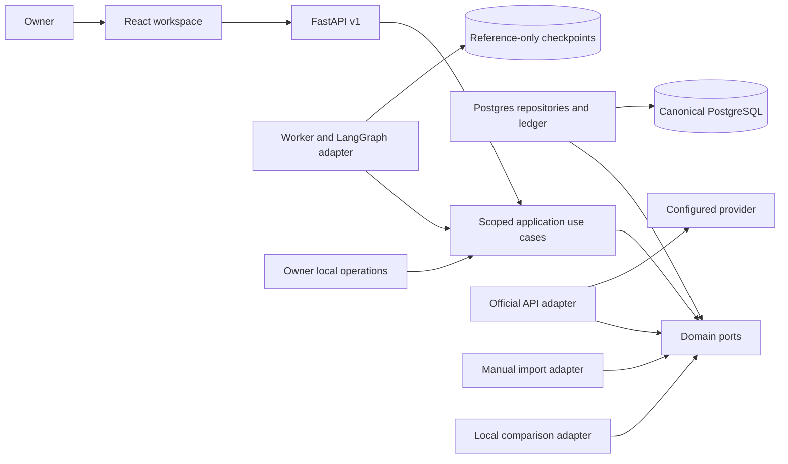
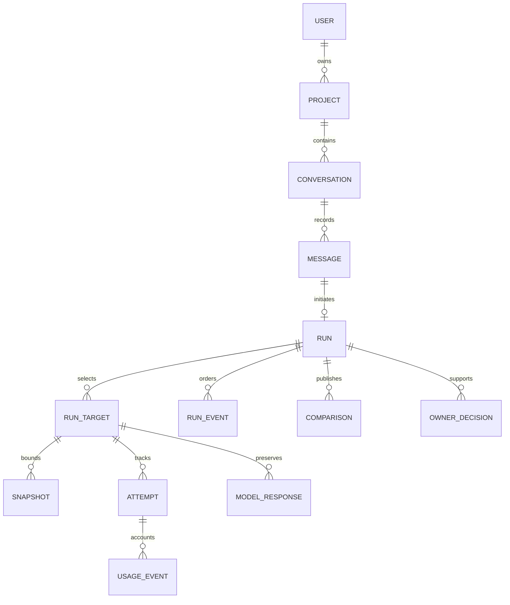

# Personal AI Decision Hub · G1 architecture candidate

**ADH-v2.0 · G0-02 · proposed, unsigned.** Proposed tag `g1-design-v2.0`. The owner approves P0 scope, tradeoffs and the freeze after an independent review. Live access and spending have a separate approval boundary. The governance document governs gates. The OpenAPI and companion schemas define wire shapes. This document defines component ownership, cross-record invariants and behavior. [Governance](../IMPLEMENTATION_GOVERNANCE_AND_DESIGN_BASELINE_v2.0.md) · [Contract](../api/openapi.yaml) · [Requirement matrix](../requirements/traceability.md) · [Decisions and conflicts](../requirements/conflict-log.md)

## 1. First usable release

An authenticated owner selects a project and conversation, asks once, chooses two or more distinct registry targets, and receives independent API answers, manually pastes originals, or combines both. The owner sees every requested slot, its original or reason for absence, the evidence-aware report and a separate action to record a decision. A later session can find the question by project-scoped text search and open the same evidence and choice. An offline comparison can use two different manual slots. Verified independent family count may be zero. A legacy one-manual-target request collects an original with an explicit insufficient-comparison label.

P0 delivers this workflow in local Compose with bounded context, cost controls, export/import, encrypted backup and recovery. P1 owns rich memory, semantic retrieval, source verification and decision revisions. P2 owns task/agent organization, external tools, schedules and optional remote protocols. See ADR-201 and the phase rows in traceability.

## 2. Components and contracts

The browser holds no provider key. The API and worker share domain contracts and transaction rules. The worker owns graph execution, claim leases and fenced writes. Checkpoints contain IDs, revisions and stage only. The application can recover using canonical rows and ordered events after loss of a checkpoint. Repositories constrain every path by authenticated owner and current project, including search, polling, originals, snapshots, reports, decisions and exports. The same owner may have two projects with different authorized sources.

| Port | Input and result | Failure/ownership rule |
|---|---|---|
| AuthorizationPort | Principal, action, resource and project → allow/deny and policy version | Sole policy decision point. “PolicyPort” in governance names this responsibility. Deny on missing scope. Hide foreign object existence. |
| ConversationRepository | Owner/project, conversation, stable message sequence and source IDs → scoped records or page | Insert question atomically with run. Stable UTC timestamps, cursors bound to scope, immutable message bytes and ordered history. |
| RunRepository | Admission or expected run revision, fenced attempt and event → committed aggregate/version | Owns target lifecycle, exact idempotent replay and terminal guard. Make transition, event and relevant evidence one transaction. |
| ContextPort | Owner, project, question, explicitly selected earlier sources and provider policy → bounded projection plus snapshot ID | Filter by ACL and recipient before selection/truncation. Deny if essential question cannot be released. Never use a sibling's first-round answer. |
| BudgetPort | Owner, target, capped input/output, tariff, quota, deadline and idempotency identity → reservation or reason | Atomic run/day/month check and ordered reconciliation. Quota unknown or price without enforceable upper bound rejects admission. |
| ProviderPort | Capabilities/estimate and frozen generation request with attempt ID, timeout, allowed model and bound → original or classified failure plus available identity/usage | No adapter may send without a valid permission and reservation. Map provider errors locally. Manual adapter accepts user-declared input and has no outbound transport. |
| ConsensusPort | Immutable run, successful originals, exact input IDs, context metadata, outcomes and version → validated comparison | Runs locally. Must abstain on unsupported relationships, retain minority evidence and identify absences. Never writes an owner decision. |
| ExportPort | Owner/project, versioned format → portable archive, or validated import into empty destination | Strip secrets and operational data. Preserve content, hashes and scope-linked evidence. |
| Reserved interfaces | MemoryPort: scoped query/review with source IDs. TaskPort: bounded request/status by project. AgentRegistryPort: versioned capability lookup. RemoteAgentPort: dispatch/status with explicit permission and budgets. | Design seams only. Future modules use existing use cases/events. No P0 memory table, agent registry, team process or tool endpoint is implied. |

Domain objects never import SQL, vendor SDK or LangGraph types. When keys or provider capabilities change, the registry and adapters absorb the change. P0 uses PostgreSQL without requiring pgvector on greenfield bootstrap. Existing prototype databases may contain the extension.

## 3. Canonical records and invariants

All IDs are stable. Store UTC timestamps, schema versions, scoped foreign keys and unique business identities in PostgreSQL. Record money in exact USD units with conservative upward rounding on reservations. Use null for unknown measured values. A prototype wire field with a required unknown sentinel keeps that sentinel for compatibility. A blank or zero never stands for unavailable usage.

| Aggregate | Canonical records and essential constraints |
|---|---|
| Identity/history | users, revocable hashed sessions, projects(owner), conversations(project), immutable messages(conversation, sequence, content, digest). Unique sequence per conversation. Derive owner from authenticated session. Composite keys or equivalent constraint triggers enforce same-project message, conversation and run links. |
| Request and targets | runs(owner, project, conversation, question message, request key/fingerprint, revision, state, deadline); run_targets(run, registry selection, frozen identity, acquisition, state). Unique owner/request key and run/slot. Store normalized request alongside its fingerprint. Identical replay returns original run after scope check; changed input with same key returns conflict. Preserve old request fingerprints and equality rules for old keys. |
| Registry and originals | provider_models holds declared app, provider, gateway, alias, model family, routing mode, eligibility and tariff/policy version. Each dispatch pins the requested configuration. model_responses keeps raw text, digest, source target/attempt, actual reported identity and confidence, source, times and inclusion. Preserve whitespace and Unicode. Uniquely associate accepted manual paste with its target and deduplicate receipt by attempt. Keep separate late receipts excluded from aggregation. |
| Context | outbound_context_snapshots identifies target/attempt, project, selected source IDs/versions, omission/redaction decisions, policy version, limits, digest of serialized permitted input and timestamps. Store only enough to reconstruct/audit approved projection. No secret, denied content or full request body in audit, events or checkpoints. Mark owner-supplied manual context as unobserved. |
| Work, accounting and events | Durable run work/lease (unique run, worker fencing token, expiry), attempt identity and receipt, usage_events, reservation and settlement identity, run events with unique monotonically increasing sequence per run, immutable audit_events with actor, action, outcome, time and trace. A grant or spend decision is durable before transport. Guard against stale worker updates. |
| Comparison | comparisons(run, version, input response IDs, coverage, algorithm/version, findings, evidence, limitations). Unique run/version. Claims have stable IDs and resolvable same-run source spans. Store as normalized records or immutable typed report children with referential validation before publication. |
| Owner choice | owner_decisions(owner/project/run, stable ID, explicit choice, optional rationale, source references, timestamp). Require at least one scoped source and an explicit owner submission. Restrict keys across projects. No generated choice, implicit revision or automatic fact adoption. |

## 4. Admission, context and spend

1. Validate authenticated owner, project/conversation, unique target slots and bounded request shape. Check an existing idempotency key before charging or acquiring work. Require same project in every explicit source. Inaccessible IDs receive the same not-found response as unknown IDs.
2. Default context to the question. The owner may select bounded prior messages by stable ID within the same project. Freeze the round's source set and per-target candidate projections at admission. Dispatch-time policy may only remove content or block the request. Impose configured input, output and deadline limits, redact according to each recipient's permission, and report differences. A restricted or unknown recipient fails closed. Never imply the hub observed an external chat's actual prompt.
3. Verify registry enablement, official recipient, verified entitlement, non-expired price/limits, enforceable input/output maximum, and no paid fallback. Calculate a conservative upper bound including full input, max output and all potentially billable provider features. Disable unbounded features. Check min(requested run limit, owner run/day/month ceilings) and applicable request/token quotas. Default paid ceiling is zero. Manual targets incur zero hub charges and do not rely on developer access. Reject whole submission before external work for invalid selection, forbidden egress or unsafe aggregate budget. API specifies the status codes.
4. In one transaction, hold the aggregate upper bound, persist message/run/targets, create initial work/event and return accepted. Lock owner/account-period ledgers consistently across concurrent runs. Charge admission against current UTC day/month, then atomically revalidate or move the undelivered reservation to the actual dispatch period before sending. Do not release the old hold unless the new window admits it. Carry unresolved prior liability conservatively across boundaries until billing can be attributed; never reset an unresolved exposure at midnight.
5. Worker leases work, reloads cancellation/deadline, permission, registry and price, freezes exact permitted request and durably records the fenced attempt before transport. If eligibility changes, block the affected target, release only proven-unsent reservations and continue eligible siblings. Respect configured concurrency; parallel branches never depend on sibling output. A disable or cancellation blocks future sends, with best-effort interruption of already started calls.
6. No transaction spans the network. A crash before proven send permits safe resumption. A crash after committed send intent with ambiguous delivery holds maximum cost and never blindly sends again. A retry requires proof of non-delivery or the provider's documented idempotency guarantee covering the entire retry window, same payload/key and reserved bounds. Attempt count, deadline and aggregate quota remain bounded. On confirmed completion reconcile known usage. If actual billing remains unknown, retain the hold. On excess billing disable the adapter and escalate. No retries or external judge are necessary for a manual comparison.

## Execution, adoption and qualification

Use the [transaction and lifecycle contract](../api/lifecycle.md), [migration and recovery contract](../api/adoption.md), [test matrix](../testing/test-matrix.md) and [comparison quality examples](../testing/comparison-fixtures.md). Prototype conformance and provider activation require separate evidence.
