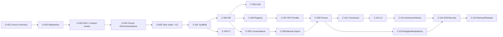

# Proposed P0 Delivery Backlog and Dependency Order

**Status:** Draft, must be reviewed and expanded into individual task cards before G1 freeze.  
**Scope:** Core multiple-model comparison MVP, not complete long-term memory or hierarchical agent org.

| ID | Deliverable | Main dependency | Mandatory acceptance / integration evidence |
|---|---|---|---|
| D-001 | Source inventory + missing-content report | Supplied docs | All three source versions recognized |
| D-002 | FR/NFR traceability and P0/P1/P2 decisions | D-001 | No silently dropped FR IDs |
| D-003 | ADRs and component boundaries | D-002 | No cross-layer SDK leakage |
| D-004 | Frozen OpenAPI, schemas, workflow states, test fixtures | D-003 | Contracts validate; all P0 testable |
| D-005 | Task cards and G1 approval candidate | D-004 | DAG acyclic; owner-facing freeze checklist |
| C-001 | Frontend/backend baseline | D-005 | Local dev boot and smoke checks |
| C-002 | PostgreSQL + migrations | C-001 | Fresh/upgrade migration test passes |
| C-003 | Auth + scoped access | C-002 | Unauthorized access denied |
| C-004 | CI + fake providers | C-001 | Deterministic tests run in CI |
| C-005 | Projects/conversations/messages | C-002,C-003 | Reopen after restart; scoped history |
| C-006 | Provider/model identity registry | C-002 | Correct family and provenance flags |
| C-007 | First real permitted provider adapter | C-004,C-006 | Contract test plus opt-in smoke test |
| C-008 | Manual import adapter | C-005,C-006 | Imported answer is explicitly user-declared |
| C-009 | Independent fan-out + run persistence | C-007,C-008 | Partial failure, timeout and independence |
| C-010 | Budget, idempotency, outbound privacy | C-009,C-003 | Over-budget blocked, duplicate submit safe |
| C-011 | Consensus comparison | C-009 | Agreement/disagreement linked to raw response IDs |
| C-012 | UI results flow | C-011,C-005 | Ask -> responses -> comparison in browser |
| C-013 | Owner decision + history | C-012 | Decision persisted with run and rationale |
| C-014 | Integration/contract/security/E2E regression suite | C-010–C-013 | Requirement mapped tests passing |
| C-015 | Backup/restore, installation, rollback and release | C-014 | Fresh install and restored database pass smoke |

## Vertical release slices

- **Slice A:** project + one API provider + manual provider + raw responses, with real persistence.
- **Slice B:** independent fan-out + comparison report, partial result support, budget limit.
- **Slice C:** user decision saved + history reopen + e2e, auth and export.
- **Slice D:** backup/restore + release gate + known-limit documentation.

**Rule:** Run cross-feature integration tests at the end of **every** slice, not only at the final release. Produce a stable demo and report before beginning the next slice.
