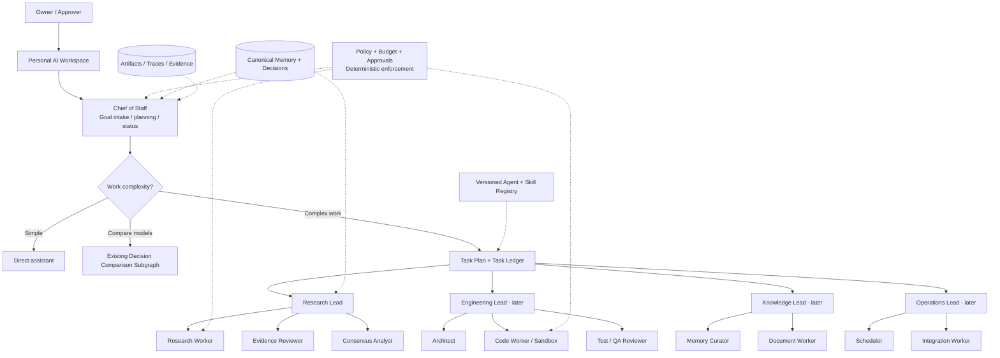
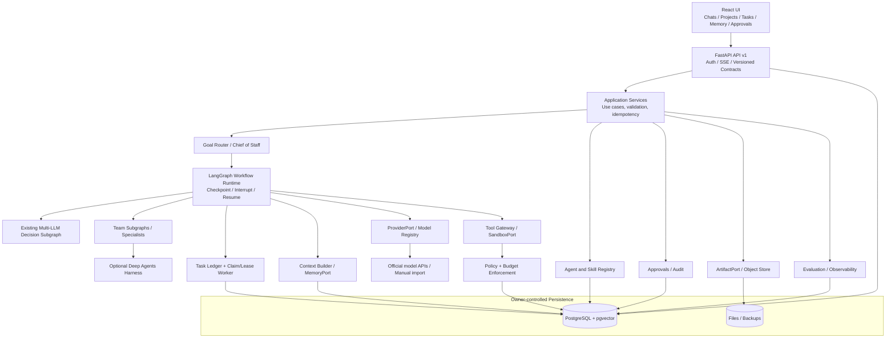
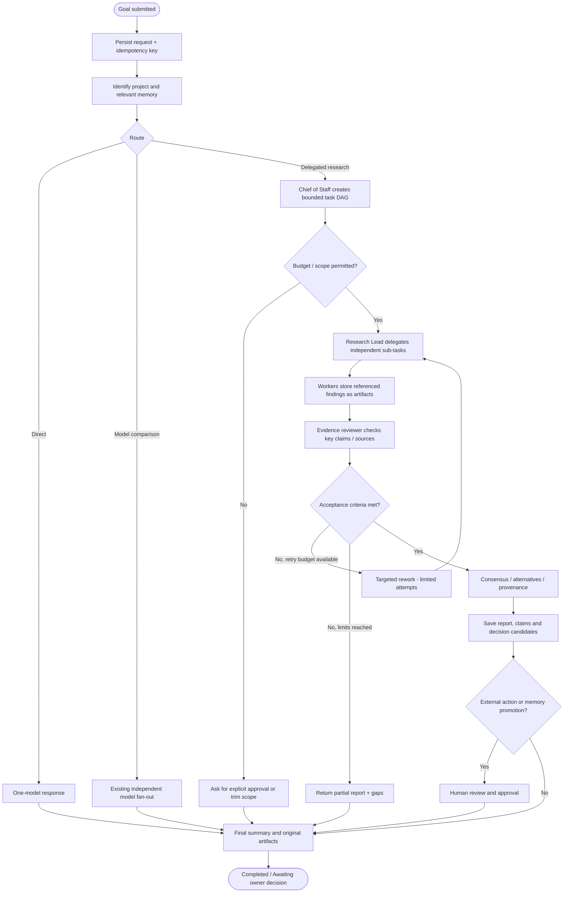
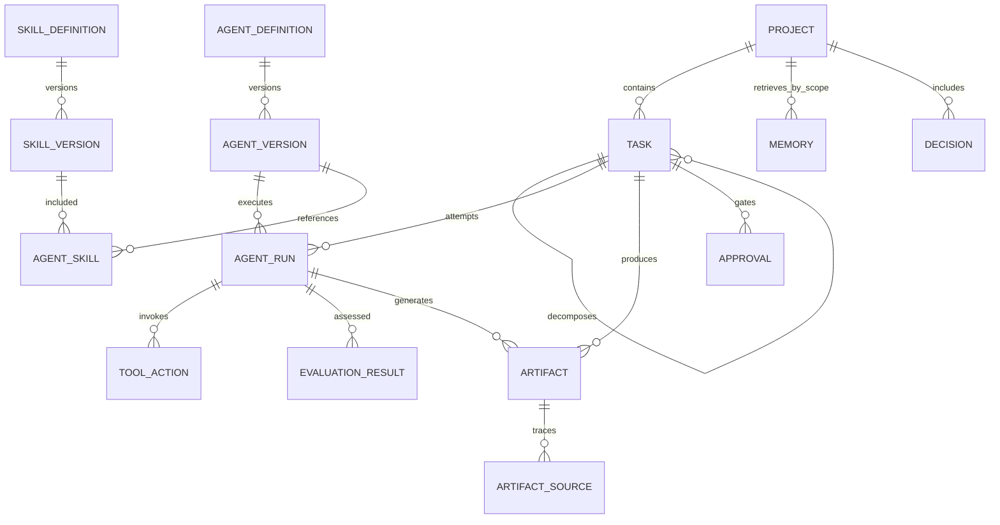
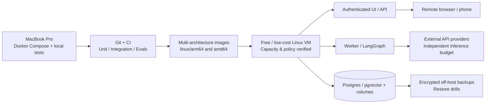

# Personal AI Decision Hub — Multi-Agent Platform: Research, Target Architecture & Implementation Roadmap

**Document ID:** PAIDH-ROADMAP-004  
**Version:** 1.4 — Proposed Implementation Roadmap  
**Research cutoff:** November 8, 2026  
**Status:** Implementation planning proposal; not a declaration of completed software  
**Language:** English — all design documentation and diagrams  
**Compatible baselines:** `AI_Decision_Hub_Requirements_Architecture_v1.2_EN.md` and `AI_Decision_Hub_Multi_Agent_Organization_Research_v1.3_EN.md`  
**Primary use:** Architecture review, implementation backlog, and Codex project handoff

> **Scope rule:** This is an additive roadmap. v1.2's conversation, model response, claim, memory, decision, provider, and workflow interfaces remain authoritative. v1.3's hierarchical organization remains a proposed extension. Do not convert either into an assumption that the application has already been built.

---

## Executive Decision

**Build a memory-first, model-independent platform and grow an on-demand agent organization around it.** Keep the existing React / FastAPI modular-monolith / PostgreSQL + pgvector / LangGraph / ProviderPort / MemoryPort architecture. Make the existing independent multi-model comparison workflow the first reusable *team capability*. Then add task tracking, a Chief of Staff, a small research team, an Agent Registry, tightly controlled execution, and—only after evaluation—an Agent Factory, engineering team, and remote agents.

**Recommended first multi-agent pilot:** one Chief of Staff (planner/router), one Research Worker, one Evidence Reviewer, and the existing Decision Analysis workflow. They run as logical roles, not as four permanent servers. **Do not build a 60-agent fleet.**

**Critical design constraints:**

- A user request can take one of three paths: direct answer, parallel model comparison, or hierarchical delegated task. Route deterministically where possible; do not spend an LLM call just to decide that a simple question is simple.
- Long-term memory is owned by the application; task execution and LangGraph checkpoints are separate from canonical evidence and decisions.
- Individual agents receive scoped context, tools, credentials, time limits, and budgets. Managers cannot extend child permissions beyond their own approved scope.
- All significant deliverables are durable **artifacts** with source references, version, owner, tests, and traceability; the Chief of Staff does not become an unverified copy-and-paste bottleneck.
- Agent definitions are immutable after activation. A new prompt/skill/tool configuration creates a new version; running tasks stay pinned to their start version.
- Free cloud resources are an optimization, **not** a correctness dependency. The platform must keep working locally and remain portable between hosts.

## 1. What the latest research changes

| Research finding | Evidence / confidence | Design implication |
|---|---|---|
| Different multi-agent patterns suit different tasks | Google Cloud's architecture patterns guide, reviewed May 2026; strong primary source | Add a three-mode router; reserve expensive hierarchy for complex tasks. |
| Lead researcher + independent parallel workers + citation verification is a proven pattern | Anthropic engineering write-up, June 2025; vendor-reported experience | Research team should gather independent evidence, store cited findings, then synthesize. |
| Cost/complexity rises quickly in multi-agent systems | Anthropic reported ~15x chat tokens for its own multi-agent research setup; not a universal ratio | Enforce model-call, token, concurrency, recursion-depth and monetary caps from day one. |
| Deep Agents is an agent harness **on top of** LangGraph, not a competing runtime | LangChain official 2026 architecture/docs | Keep LangGraph. Evaluate Deep Agents for specialist workers after the core task protocol is stable. |
| Subagents are valuable for context isolation, not for every small task | LangChain Deep Agents docs | Keep worker context narrowly scoped; return structured results and artifact IDs. |
| A2A addresses remote independent agent interoperability | A2A latest specification / tasks and agent cards | Reserve an A2A adapter but do not require A2A for same-process LangGraph subgraphs. |
| Agent autonomy creates privilege and prompt-injection hazards | OWASP AI Agent Security Cheat Sheet and Excessive Agency | Policy decisions live in deterministic code, outside model prompts; approval gates for writes, external actions, credentials and untrusted code. |
| Free VM services have limits, capacity constraints and possible reclaim policies | Oracle Always Free / Google Cloud Free Tier official documentation | Run locally first. Make cloud rollout a measured gate, with backup/restore and a paid fallback decision. |

### Relevant framework assessment

| Framework / mechanism | Decision | Reason and trigger to reconsider |
|---|---|---|
| **LangGraph** | **Primary workflow runtime** | Explicit state, branching, subgraphs, checkpointing and interruption; reconsider only if objective tests show blocking limitations. |
| **LangChain Deep Agents** | **Optional worker harness, evaluate in a spike** | Provides subagents, filesystem context, skills and sandbox interfaces; avoid making it the only owner of task/memory data. |
| **CrewAI / Google ADK / OpenAI Agents SDK** | **Reference patterns or future adapter** | Useful abstractions, but a second runtime now adds complexity without solving a demonstrated gap. |
| **Mem0 OSS** | **Optional MemoryPort adapter** | Test extraction accuracy, local embedding costs and delete semantics; keep canonical memory in our schema. |
| **Letta / MemGPT approach** | **Borrow core-memory/agent-state principles** | No mandatory second server for MVP. |
| **MCP** | **Future tool adapter** | Use for permitted external tools; all calls still pass through platform policy. |
| **A2A** | **Future remote-agent protocol** | Introduce only when agents run in separate products/processes/hosts and need task-level interoperability. |
| **Postgres-backed task ledger** | **Phase 1–2 task coordination** | Sufficient for single-owner low concurrency; add Redis/queue only upon measured operational need. |

## 2. Architecture invariant: what does not change

The original system's **Conversation → Run → Model Responses → Claims → Consensus → Decision** chain remains intact. Project Memory, Episodic Memory, Core Memory, Semantic Memory, Decision Memory, and Workflow State stay distinct. Their ownership does not move into an Agent framework.

New components are added *around* existing ports:

- `TaskPort` / Task Ledger
- `AgentRegistryPort` / versioned Agent Specs
- `SkillPort` / versioned skill definitions
- `DelegationPort` / Chief of Staff, team subgraphs
- `PolicyPort` / non-LLM authorization and budget preflight
- `ArtifactPort` / versioned output, file hashes, provenance
- `EvaluationPort` / offline and run-time evaluators
- optional `SandboxPort`, `SchedulerPort`, `RemoteAgentPort`

No replacement of `ProviderPort`, `MemoryPort`, `WorkflowPort` or `DecisionPort` is required. Use a database migration in expand → backfill → switch → contract order for any future breaking requirement.

## 3. Target logical organization



**Important:** The graph above shows *roles*, not permanent processes. The only human-facing conversational agent is Chief of Staff. Leads coordinate, workers return bounded results. The platform runs one selected workflow at a time (or bounded parallel tasks) with no unconstrained recursion.

## 4. Target technical component architecture



### Module ownership and boundary rules

| Module | Owns | Does not own |
|---|---|---|
| `identity` | owner account, sessions, authentication, authorization | model-generated permissions |
| `conversation` | project, messages, original provider responses | inferred user facts |
| `memory` | candidate extraction, typed memory, provenance, revisions, deletion | immutable raw source messages |
| `decision` | options, claims, evidence and signed-off choices | external API execution |
| `agents` | AgentSpec versions, TeamSpec, SkillSpec and activation state | free-form access to credentials |
| `tasks` | goal, steps, dependencies, leases, runs, artifacts and status | provider internal token histories |
| `workflows` | LangGraph state transitions, checkpoint/resume, routing | independent source of truth for decisions |
| `providers` | model identity, request and response, error handling, price accounting | user memory governance |
| `policy` | allow/deny, approvals, spend and tool permissions | approval by model inference alone |
| `tools` | integrations and sandbox execution | broad host filesystem or network by default |
| `evaluation` | test cases, scores, regression results and run traces | deleting source evidence |

## 5. Example end-to-end workflow

**User goal:** “Research the best memory-indexing architecture for AI Decision Hub and prepare an implementation proposal.”



### Agent task contract (minimum)

Every delegation must specify `goal`, `task_id`, `parent_task_id`, `agent_spec_version`, `project_id`, `input_artifact_refs`, `memory_scope`, `allowed_tools`, `privacy_tier`, `acceptance_criteria`, `max_model_calls`, `max_cost_usd`, `max_wall_seconds`, `max_depth`, `output_schema`, and `approval_policy`. The child returns `status`, `summary`, `artifact_refs`, `claim_refs`, `source_refs`, `usage`, `limitations` and `trace_id`.

**Failure semantics:** bounded retries with backoff for transient errors; stop-on-budget; partial completion when one provider/worker fails; checkpoint at durable boundaries; idempotent external effects; no infinite replan loops. Tool calls that alter external state use an approval token plus a unique `action_id` recorded before execution. Replays must check this record rather than repeating the side effect.

## 6. Data model: additive extensions to v1.2



| Entity | Essential fields | Rules |
|---|---|---|
| `agent_definition` | `id`, `slug`, `name`, `status`, `owner_id` | Stable identity; no inline mutable production prompts. |
| `agent_version` | `id`, `agent_id`, `semver`, `instructions_ref`, `model_policy_json`, `input_schema_json`, `output_schema_json`, `tool_allowlist_json`, `permission_ceiling_json`, `memory_policy_json`, `max_depth`, `checksum`, `state` | Immutable once `active`; new changes create new row. |
| `skill_version` | `id`, `skill_id`, `semver`, `content_ref`, `risk_tier`, `checksum` | Human-reviewed high-risk tool skills. |
| `task` | `id`, `project_id`, `parent_task_id`, `goal`, `acceptance_json`, `status`, `priority`, `budget_json`, `idempotency_key`, `created_at` | DAG dependencies in join table; task transition validation. |
| `task_dependency` | `task_id`, `depends_on_task_id` | Cycle prevention; no child can start until dependencies terminal-success or approved override. |
| `agent_run` | `id`, `task_id`, `agent_version_id`, `model_id`, `status`, `lease_expires_at`, `attempt`, `trace_id`, `checkpoint_thread_id`, `usage_json` | Pin AgentSpec and model identity at start. |
| `artifact` | `id`, `task_id`, `run_id`, `kind`, `uri`, `sha256`, `media_type`, `metadata_json`, `created_at` | Durable content; version refs and provenance; scan files before processing. |
| `artifact_source` | `artifact_id`, `source_type`, `source_id`, `citation_locator` | Evidence links to raw message, source URL, files, model claim. |
| `approval` | `id`, `task_id`, `action_id`, `risk_tier`, `request_json`, `status`, `decider_id`, `expires_at` | Immutable audit of request and decision; human-only escalation. |
| `tool_action` | `id`, `run_id`, `idempotency_key`, `tool_id`, `risk_tier`, `status`, `request_hash`, `result_ref` | Pre-authorized; idempotent external effects or explicit compensation. |
| `evaluation_case/result` | `case_id`, `rubric_version`, `run_id`, `metric`, `score`, `evidence_ref` | Comparison by pinned prompt/model/version; allow human review. |
| `run_event` | `run_id`, `sequence_no`, `event_type`, `payload_json`, `created_at` | Append-only event timeline for SSE and audit. |

**Canonical relationships:** Agent runs reference task IDs and existing `project`, `conversation`, `model_run`, `memory`, `claim`, and `decision` IDs; never duplicate those records as a second private agent memory database. Use `project_id` and `privacy_scope` for all retrieves. Maintain retention, redaction and deletion cascades across vector indexes, materialized traces and backups.

## 7. API contracts (proposed additive `/api/v1` routes)

| Method | Route | Responsibility |
|---|---|---|
| `POST` | `/api/v1/tasks` | Create a goal/task; require `Idempotency-Key`. |
| `GET` | `/api/v1/tasks/{id}` | Goal status, tasks, budget usage, artifacts and checkpoint reference. |
| `GET` | `/api/v1/tasks/{id}/events` | Server-Sent Events replay from last event ID. |
| `POST` | `/api/v1/tasks/{id}/cancel` | Cancellation request and child propagation. |
| `POST` | `/api/v1/tasks/{id}/resume` | Resume only after permission/input validation. |
| `GET` | `/api/v1/agents` | Active agent specs and versions. |
| `POST` | `/api/v1/agents/drafts` | Create agent draft; no privileged activation. |
| `POST` | `/api/v1/agents/{id}/evaluate` | Run sandboxed acceptance cases. |
| `POST` | `/api/v1/agents/{id}/activate` | Authorized promotion of immutable version. |
| `GET` | `/api/v1/approvals` | Pending/recent approvals. |
| `POST` | `/api/v1/approvals/{id}/decision` | Explicit allow/deny with nonce and expiry. |
| `GET` | `/api/v1/artifacts/{id}` | View/download authorized evidence or deliverable. |
| `GET` | `/api/v1/observability/runs/{id}` | Trace, cost, tool action, agent lineage. |

**Example task submission:**

```json
{
  "project_id": "proj_ai_hub",
  "goal": "Compare two memory-indexing designs and create a reviewed proposal",
  "execution_mode": "auto",
  "constraints": {
    "max_parallel_agents": 3,
    "max_delegation_depth": 2,
    "max_total_model_calls": 18,
    "max_cost_usd": 0.50,
    "max_wall_seconds": 600,
    "external_actions": "require_approval"
  },
  "deliverables": ["comparison_report", "architecture_proposal"],
  "acceptance_criteria": ["Claims trace to sources", "Two alternatives evaluated"]
}
```

**Example accepted response:** `202 Accepted` with `task_id`, `status`, `status_url`, `events_url`, and `trace_id`. `GET /tasks/{id}` returns one of `draft`, `queued`, `running`, `awaiting_approval`, `partially_completed`, `completed`, `failed`, `cancelled`. All resources include `schema_version`, `created_at` and access-control checks. Existing `/api/v1/runs`, `/api/v1/memories`, `/api/v1/decisions` remain unchanged.

## 8. Execution / durability model

### Step-by-step runtime

1. **API transaction:** authenticate; apply project authorization, privacy policy, schema validation, idempotency; persist the task and `task.created` event atomically.
2. **Worker claim:** separate worker polls PostgreSQL for eligible queued tasks using short transactions and `FOR UPDATE SKIP LOCKED`, acquires a renewable lease, and pins agent version and execution budget. This is an **implementation proposal** for small scale, not a LangGraph-native queue guarantee.
3. **Graph invoke:** start/resume named LangGraph graph with persistent Postgres checkpoint keyed by `task_id` / `thread_id`. Avoid placing full documents/secrets in graph state; use durable references.
4. **Tool execution:** Tool Gateway checks scope, tool allowlist, approval and budget just before the action. External effects recorded with idempotency key; retry only when safe.
5. **Checkpoint / event:** persist step boundary, task event, model-call usage and output artifact. Apply bounded timeouts and retries.
6. **Human interruption:** pause graph and preserve state for approval. Ensure a rejected approval terminates the pending action without silently trying another route.
7. **Completion:** validate output schema, evaluation results, claims and citations; set status, emit completion event; stage memory candidates separately.
8. **Crash recovery:** tasks with expired lease become eligible for recovery; re-run from last durable checkpoint and skip already-recorded external actions.

**No ephemeral-only state in worker RAM:** state required for restart must be in Postgres/files. Avoid silently assuming `asyncio.create_task` survives process or VM shutdown. A future dedicated queue can replace the claim implementation behind `TaskPort`.

## 9. Governance / security tiers

| Tier | Action examples | Default policy |
|---|---|---|
| T0 | read own public docs, analyze, create draft | Auto within budget and project scope. |
| T1 | write to temporary project sandbox, propose memory update | Auto in sandbox; owner approval for promoting long-term sensitive memory. |
| T2 | modify repository working tree, open pull request, access connected external records | Per-tool scoped access, validation, review; approval where needed. |
| T3 | send messages, publish/deploy, modify live integrations, change access settings | Human pre-approval with specific action payload and expiry. |
| T4 | payments, account deletions, irreversible/high-risk administrative actions | Disabled by default; explicit exceptional enablement, never delegated by Agent Factory. |

Additional controls: untrusted retrieved text is data, never trusted system instruction; tokenize and redact private context before third-party calls; prevent cross-project retrieval; keep API keys in environment/secrets not in persisted prompts; protect backups; audit model and tool action usage; enforce hard no-escalation permission ceilings; prevent prompt/skill injection via untrusted repositories.

## 10. Deployment path and cost boundaries



- **Local-first (required):** run `web`, `api`, `worker`, `db` via Docker Compose; use fixtures and mock providers for reliable tests. Local development works when all external APIs are temporarily unavailable.
- **Cloud-first candidate:** Oracle Always Free Ampere A1 VM currently advertises 2 OCPUs / 12 GB RAM within Always Free allocations, but there are account, region, capacity and idle-reclamation constraints. Treat provisioning as a research gate rather than a guarantee. Use ARM64-compatible images. [Oracle docs]
- **Alternative:** Google Compute Engine's Always Free `e2-micro` is much smaller and region-bound. It is not a good default for multi-container Postgres + worker without empirical memory measurements. Google Cloud Run can host stateless containers within usage-dependent free allocations but still requires durable database/storage and design changes.
- **Security:** use a private network or carefully authenticated HTTPS reverse proxy; never expose PostgreSQL or arbitrary agent execution ports publicly.
- **Disaster recovery:** nightly encrypted logical backup, weekly restore drill at first; backups stored independently of the free VM; set retention and validate storage/network costs.
- **Cloud migration gate:** do not move until local functional/evaluation gates pass, multi-arch images work, backup/restore is tested and the selected provider's actual free allocation is verified.
- **Inference is separate:** consumer chat subscriptions and free cloud VM quotas are not equivalent to production inference API entitlement. API requests must be capped and their charges/limits measured.

## 11. Milestone roadmap — dependencies and acceptance gates

The milestones are **ordered by dependency**, not promises about elapsed calendar time. Do not start all workstreams simultaneously. Each must produce testable deliverables before the next gate is considered passed.

| ID | Milestone / outcome | Key engineering steps | Evidence / exit gate | Dependency |
|---|---|---|---|---|
| **M0** | Baseline & decisions locked | Reconcile v1.2/v1.3 requirements, ADRs, domain terms, repo structure, provider eligibility and security assumptions | Signed-off architecture map, traceable backlog, risks and reproducible environment | None |
| **M1** | Portable platform skeleton | Create FastAPI, React, Postgres/pgvector, migrations, auth, Docker Compose, CI, logging and health checks | `docker compose up` works on Mac; smoke tests and DB migration/rollback pass | M0 |
| **M2** | Multi-LLM Comparison MVP | ProviderPort, model identity registry, manual import, independent fan-out, original answer retention, blinded consensus | Three-source test including failures; outputs with original text, usage, claims and citations | M1 |
| **M3** | Persistent Memory & Decisions | Core/project/episodic/semantic/decision memory, retrieval scopes, provenance, revise/delete, backup/restore | Cross-session retrieval, conflicting-version test, delete test and successful restore | M2 (some work parallel after M1) |
| **M4** | Task Ledger & Durable Workflow | Task API, bounded status machine, worker claim/lease, LangGraph checkpoint/resume, cancellation, SSE, cost limits | Kill/restart during task; no lost record or repeated external side effect; client sees status | M1, M3 |
| **M5** | Chief of Staff + Research Pilot | Three-way route, planner, Research Worker, Evidence Reviewer, existing Comparison as subgraph, artifact handoff | End-to-end research task, provenance, budget, visible failures, manual corrections | M2–M4 |
| **M6** | Agent Registry & Lifecycle | Versioned AgentSpec + Skills, activation controls, evaluation harness, dynamic selection among approved roles | New role created as draft, evaluated, approved, invoked; old running task unchanged by upgrade | M5 |
| **M7** | Controlled Agent Factory + Engineering | Agent Factory drafts agent specs/tests, code sandbox, Git branch/PR workflow, QA gate and audit | Demonstrated safe draft→test→approve→activate; no unauthorized host or repo write | M6 |
| **M8** | Cloud Access & Operational Maturity | ARM64 image, authenticated remote access, restore rehearsal, alerts, cost dashboards, owner guide | Phone/browser remote access; 30-test regression suite; budget/security/backup gates | M5 for remote research; M7 for remote code agents |
| **M9** | Optional Remote Agent Ecosystem | A2A adapter, MCP tool integrations, multi-project policy, scalable queue, skill marketplace | Only after measurable demand and interoperability tests | M6–M8 |

### Suggested thin vertical slices (do these first)

**Slice A (M1–M2):** Ask one question → call one free/authorized API + manually import second answer → preserve originals → compare → show in UI.  
**Slice B (M3):** Resume the same project in a new session → recover one prior decision and its original supporting sources.  
**Slice C (M4–M5):** “Research X” → Chief creates tasks → Research Worker collects sources → Evidence Reviewer verifies → Chief returns cited report → crash/restart retains task.  
**Slice D (M6):** Add a second version of an approved Agent, regression-test it, promote it and prove the earlier task stays pinned to the original version.

### Definition of done for *each* milestone

- Functional behavior demonstrated, including at least one negative/failure case.
- API, schema migration, prompt/agent versions and Mermaid diagrams updated in the same commit.
- Unit/integration/eval tests green; measured cost and latency captured.
- Access-control and privacy boundaries explicitly tested.
- Logs/traces and an operator recovery procedure exist.
- No requirement is claimed completed merely because an Agent produced a convincing plan.

## 12. Initial engineering backlog — ordered implementation steps

| Step | Milestone | Build ticket | Expected artifact |
|---|---|---|---|
| 01 | M0 | Establish requirements traceability and architecture ADR index | `docs/requirements/`, `docs/adr/` |
| 02 | M0 | Verify concrete API accounts, free quotas, restrictions, model identities | `docs/research/provider-matrix.md` |
| 03 | M0 | Define stable `Task`, `AgentSpec`, `Artifact`, `Approval` schemas | `contracts/domain/` |
| 04 | M1 | Scaffold monorepo Python/FastAPI, frontend and test folders | reproducible repository |
| 05 | M1 | Provision local Postgres + pgvector + Alembic | Compose + migrations |
| 06 | M1 | Owner authentication, project scoping, secrets handling | auth middleware/tests |
| 07 | M1 | CI lint, typed tests, schema checks, mock model server | automated pipeline |
| 08 | M2 | Implement `ProviderPort` and one provider adapter | provider contract tests |
| 09 | M2 | Implement manual import and model provenance metadata | UI/API feature |
| 10 | M2 | Multi-model independent run, usage ledger, partial failure | comparison graph |
| 11 | M2 | Consensus with claim/evidence links, originals visible | decision report view |
| 12 | M3 | Memory schema with revisions/provenance and projection tests | memory migrations |
| 13 | M3 | Context Builder with token budget, privacy checks and manifest | context tests |
| 14 | M3 | Project/decision continuity and explicit user correction | UI/retrieval test |
| 15 | M3 | Encrypted backup + restore script and test | backup runbook |
| 16 | M4 | Task status machine and Postgres claim/lease protocol | task service |
| 17 | M4 | LangGraph Postgres checkpointer, interrupt/resume & cancellation | durable workflow tests |
| 18 | M4 | Append-only task/run events with SSE replay | status timeline UI |
| 19 | M4 | Tool action idempotency and hard limit enforcement | negative security tests |
| 20 | M5 | Goal classifier / direct-vs-comparison-vs-delegation router | routing eval suite |
| 21 | M5 | Chief of Staff planning and project-aware task DAG | planning graph |
| 22 | M5 | Research Worker + Evidence Reviewer + artifact handoff | research subgraph |
| 23 | M5 | End-to-end review with known-answer / source-grounded cases | evaluation dashboard |
| 24 | M6 | Versioned agent/skill registries and immutable activation | registry UI/API |
| 25 | M6 | Agent spec evaluation cases, promotion/rollback policy | agent lifecycle tests |
| 26 | M7 | Agent Factory drafts, never self-activates | proposal generator |
| 27 | M7 | Isolated code sandbox, Git changes and QA verifier | engineering pilot |
| 28 | M8 | Multi-arch image build, remote access, off-VM backup/restore | cloud deploy scripts |
| 29 | M8 | Cost, failure, memory leakage, audit and release smoke tests | operator handbook |
| 30 | M9 | A2A / MCP proof of concept only if needed | interoperability ADR |

## 13. Evaluation program and release gates

Evaluation starts **before** Agent Factory. Maintain versioned fixtures covering direct answer, independent comparison, memory retrieval, conflicting facts, project continuation, source hallucination, agent task decomposition, denied tool access, prompt injection, budget overflow, interrupted job resume, cancelled job, and retries.

| Metric / check | Proposed initial gate (engineering target, not a published benchmark) |
|---|---|
| Original answer traceability | 100% of comparison results link to immutable raw model responses. |
| Decision provenance | 100% of saved decisions link to evidence or explicit owner rationale. |
| Task persistence | 100% of scripted crash/restart tests preserve terminal or recoverable status. |
| Forbidden actions | 0 unauthorized external write operations in security tests. |
| Model call budget | 0 over-budget starts; ongoing in-flight costs accounted for conservatively. |
| Agent version reproducibility | 100% of runs pin prompt/tool/skill/model policy version. |
| Memory project isolation | 0 cross-project unauthorized retrievals in test suite. |
| Research citation quality | 90%+ verified major claims in curated test set; human-review exceptions flagged. |
| Regression performance | No material functional drop compared with previous passing release; track latency, tokens and cost rather than invent fixed benchmarks. |
| User utility | Owner can finish and recover an actual research project with fewer manual transfers than separate chat apps. |

Use deterministic code assertions where possible; LLM-as-judge only for nuanced quality and always with sampling/human review. Add offline golden tests to CI, then small online samples to production. Trace source selection, model IDs, agent versions, tool calls and cumulative cost. A sophisticated architecture with no evaluation is not production-ready.

## 14. Research spikes that must precede optional choices

| Spike | Question | How to test | Decision threshold |
|---|---|---|---|
| R1: Deep Agents | Does its subagent/filesystem harness reduce code versus our custom LangGraph subgraph? | Implement the same three-step research task in both styles; compare API stability, tracing, cost and recovery | Adopt as an *optional* `SpecialistHarnessPort` only if benefits are clear. |
| R2: Mem0 OSS | Can memory extraction and deletion be done with low/no-cost model and acceptable accuracy? | Run 50–100 multilingual conversation fixtures with provenance and contradiction tests | Keep adapter optional; never make proprietary memory store canonical. |
| R3: Provider eligibility | Which free/authorized APIs can be called programmatically in this account/region? | Read developer terms and perform small authenticated calls | No browser-login automation dependency; verify model identity. |
| R4: Sandbox | Which execution backend isolates code, filesystem, network, and credentials on Mac vs cloud ARM64? | Controlled exploit-like tests and resource limits in disposable environments | No arbitrary coding-agent shell on host VM. |
| R5: Cloud | Is Oracle Always Free A1 actually provisionable and stable for this user? | Account/region capacity check, 1-week memory/CPU measurement, backup/restart rehearsal | Deploy only after local is stable; have fallback. |
| R6: Memory curation | What should be auto-written vs proposed for review? | Replay change-of-mind, sensitive detail, model disagreement fixtures | Facts/decisions only promoted under governed rules. |
| R7: A2A and MCP | Do independent remote agents/tools require protocols now? | Prototype one read-only remote agent and one MCP tool in isolation | Implement only if cross-runtime interoperability becomes real. |
| R8: Task queue | Does Postgres claim/lease suffice at expected concurrency? | Load test concurrent task claims, lease expiry, VM restart, SSE | Add a queue only if measurable throughput or reliability constraints require it. |

## 15. Risks, mitigations and architectural triggers

| Risk | Mitigation | Trigger to reconsider architecture |
|---|---|---|
| Infinite delegation / runaway spend | max depth, max total calls, tokens, task duration and cost in policy engine | Tasks frequently hit caps despite useful progress: refine workflow decomposition, not remove caps. |
| Unverified model output contaminates memory | keep claims separate; curated memory candidates; source and time validity | Failed provenance or conflicting memory evaluation. |
| Chief of Staff becomes bottleneck | ArtifactPort returns references, structured summaries, independent verifier | Large reports lost or paraphrased inaccurately. |
| Postgres used as a simplistic queue | leases, idempotency, monitoring, SKIP LOCKED; transactional events | High queue depth, frequent contention or external event needs. |
| Free VM unavailable/reclaimed | self-contained Docker, snapshots, off-host restore, host-agnostic deployment | Provisioning rejected / VM reclaimed / persistent resource pressure. |
| Framework upgrades break agents | pin dependency versions, contract tests, dual-version rollout and migration strategy | Incompatible API changes; adapt harness behind port. |
| Tool / prompt injection and privilege escalation | policy enforcement outside LLM, least privilege and approval tokens | Any unauthorized call in red-team test blocks release. |
| Memory privacy spills across providers | per-provider context manifests and redaction | Incorrect context sent to wrong provider blocks release. |
| Agent Factory produces unsafe roles | draft-only proposal, tests, independent approval, version pinning | No self-activation or self-escalation, ever. |

## 16. Recommended immediate next step: Codex kickoff

**Start at M0, then implement a small vertical slice—not a company-shaped dashboard.** The first useful delivery is a working local system that can ask a question, preserve an answer and source, and continue the same project later.

### Repository layout

```text
ai-decision-hub/
  README.md
  AGENTS.md
  docs/
    architecture/       # v1.2 baseline, v1.3 extension, this v1.4 roadmap
    adr/                # numbered architecture decisions
    requirements/       # requirement IDs and traceability
    research/           # provider, memory, framework spike results
  contracts/
    openapi/
    domain/             # Pydantic schemas and JSON Schema snapshots
    events/
  apps/web/             # React and task status UI
  services/api/         # FastAPI modular monolith
  services/worker/      # LangGraph task runner
  packages/domain/      # canonical entities and ports
  packages/adapters/    # provider, memory, db, sandbox adapters
  packages/workflows/   # comparison, research, engineering subgraphs
  migrations/           # Alembic / PostgreSQL
  skills/               # vetted, versioned skills
  evals/                # curated fixtures and regression reports
  infra/docker/         # Compose and environment samples
  infra/cloud/          # optional ARM64 cloud deployment
  scripts/              # backup, restore, health, smoke tests
```

### Codex kickoff instruction (copy into your engineering project)

> Treat `v1.2_EN` as the canonical requirements/architecture baseline, `v1.3_EN` as a proposed multi-agent extension, and `v1.4_EN` as the implementation roadmap. All generated design files, code comments, diagrams and specifications must be in English. Preserve existing domain boundaries and endpoints. Begin with M0: create a requirements traceability matrix, ADR-001 to ADR-006 draft decisions, a repository plan, and a detailed M1 implementation backlog with tests. Do **not** implement Agent Factory, remote shell execution, unrestricted browser automation, or cloud deployment yet. Use Docker Compose and reproducible mock model providers. Each change must include tests, updated diagrams/contracts, explicit security/cost considerations, and a demonstration of the acceptance gate.

### First review meeting / design gate

Confirm (1) first release scope (M1–M3), (2) supported provider(s) and legitimate free API entitlement, (3) memory storage and delete semantics, (4) approval/privacy tiers, (5) first demonstration scenario, (6) acceptable monthly API spend, and (7) how cloud rollout will be gated. These are the only decisions that could materially affect the initial build.

## 17. Architecture Decision Records — proposals

| ADR | Decision | Status |
|---|---|---|
| ADR-001 | Preserve modular monolith and existing v1.2 canonical model; add capabilities via ports | Proposed for approval |
| ADR-002 | LangGraph as sole authoritative workflow runtime, Deep Agents as optional harness | Proposed |
| ADR-003 | Postgres task ledger for initial low-volume worker coordination | Proposed pending resilience spike |
| ADR-004 | Policy-and-budget engine outside the LLM; default-deny high-risk tools | Proposed non-negotiable |
| ADR-005 | AgentSpec and SkillSpec versioned/immutable after activation | Proposed non-negotiable |
| ADR-006 | Artifact references and provenance instead of copying intermediate outputs across managers | Proposed |
| ADR-007 | Cloud free tier is optional and never the only copy of project data | Proposed non-negotiable |
| ADR-008 | A2A, MCP and Agent Factory are optional extension points, not MVP dependencies | Proposed |

## 18. Sources and verification notes

Primary references, accessed or checked November 8, 2026:

1. Google Cloud, *Choose a design pattern for your agentic AI system* (last reviewed 2026-05-28): https://docs.cloud.google.com/architecture/choose-design-pattern-agentic-ai-system
2. Anthropic Engineering, *How we built our multi-agent research system* (2025-06-13): https://www.anthropic.com/engineering/multi-agent-research-system
3. LangChain Deep Agents architecture: https://github.com/langchain-ai/deepagents/blob/main/libs/ARCHITECTURE.md
4. LangChain Deep Agents overview: https://docs.langchain.com/oss/python/deepagents/overview
5. LangChain Deep Agents subagents: https://docs.langchain.com/oss/python/deepagents/subagents
6. LangGraph design/persistence overview: https://docs.langchain.com/oss/python/langgraph/overview and https://docs.langchain.com/oss/python/langgraph/persistence
7. LangSmith evaluation approaches: https://docs.langchain.com/langsmith/evaluation-types
8. OWASP, *AI Agent Security Cheat Sheet*: https://cheatsheetseries.owasp.org/cheatsheets/AI_Agent_Security_Cheat_Sheet.html
9. OWASP, *Excessive Agency*: https://genai.owasp.org/llmrisk/llm062025-excessive-agency/
10. Agent2Agent specification: https://a2a-protocol.org/latest/specification/agent-card/ and https://a2a-protocol.org/latest/topics/life-of-a-task/
11. Oracle Cloud, *Always Free Resources*: https://docs.oracle.com/en-us/iaas/Content/FreeTier/freetier_topic-Always_Free_Resources.htm
12. Google Cloud, *Free cloud features*: https://docs.cloud.google.com/free/docs/free-cloud-features
13. Google Cloud, *Cloud Run pricing and free tier*: https://cloud.google.com/run/pricing

**Verification boundary:** These sources describe platform capabilities and published service policies, not entitlements to the owner's individual accounts. Framework API details and billing quotas must be rechecked at implementation time. The short-video story motivating this extension is not treated as proof of a literal 60-agent organization.

---

**Recommended disposition:** Approve this as a *planning baseline*; do not label any milestone implemented until its acceptance tests pass. Keep this Markdown file and Mermaid diagrams as the editable source of truth. Generate Word/PDF as review derivatives, not as separately edited design sources.
