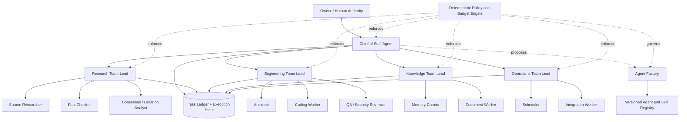
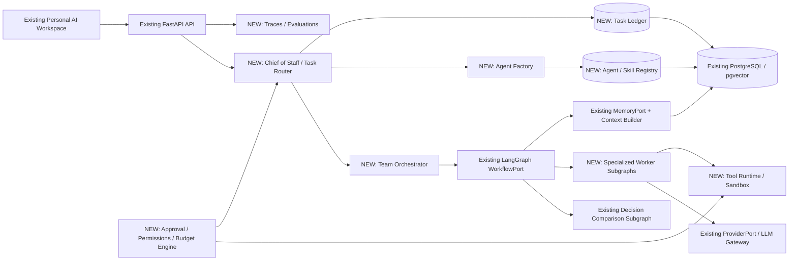
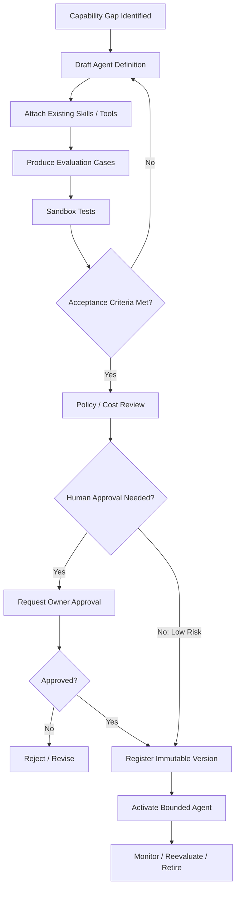
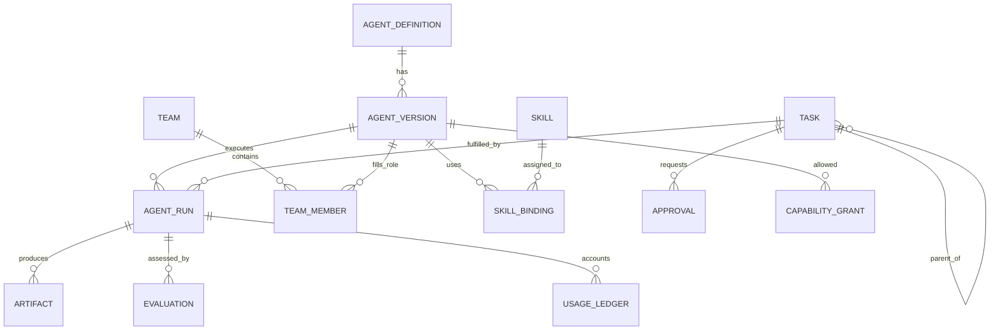
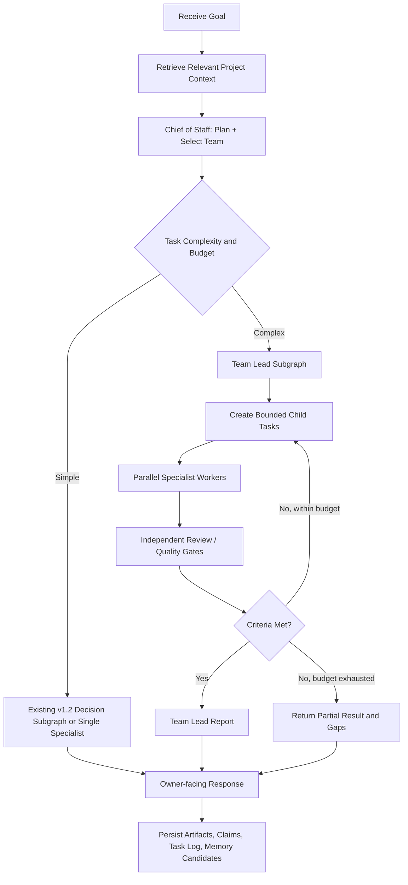

# Personal AI Decision Hub — Multi-Agent Organization Research and Architecture Extension

**Document ID:** PAIDH-EXT-002  
**Version:** 1.3 Research Addendum  
**Date:** November 8, 2026  
**Status:** Proposed extension; does not replace the approved v1.2 architecture baseline  
**Language:** English  
**Parent architecture:** `AI_Decision_Hub_Requirements_Architecture_v1.2_EN.md`

## Executive Summary

The current Personal AI Decision Hub is a memory-first, model-independent platform for collecting independent LLM answers, comparing claims, preserving conversations, and recording decisions. A natural next evolution is an **Agent Organization Platform**: one owner-facing Chief of Staff delegates work to specialist teams, which may start bounded workers, collect artifacts, request quality checks, and report progress. The design preserves all existing v1.2 domain contracts and adds capabilities through extension modules.

**Recommendation:** Preserve LangGraph, FastAPI, PostgreSQL/pgvector, MemoryPort, ProviderPort, and Docker Compose. Extend with an Agent Registry, Task Ledger, Team Orchestrator, Skill Registry, Agent Factory, Evaluation Service, Budget Controller, and policy-enforced tool execution. Build a **2–4-agent pilot**, not a permanent 60-agent fleet. Grow in stages using measured success, latency, cost, and safety.

## 1. Research Findings and Claim Verification

### 1.1 Identifying the viral story

A strong match is a September 27, 2026 *Behind the Craft* interview by Peter Yang with Lauren Tan and Peng Zheng, described as the lead engineer and designer working on Grok Bot at SpaceXAI. It presents 14 bots used for work and life, including a chief of staff, an engineering lead named Matcha that delegates rather than codes, multiple engineering bots, and **Dr. Eggbot**, which designs and audits other bots. One engineering bot can launch cloud coding agents. See the original show notes: https://creatoreconomy.so/p/grok-bot-team-14-best-bots-peng-zheng-lauren-tan and Apple Podcasts https://podcasts.apple.com/us/podcast/we-built-grok-bot-here-are-our-14-best-bots-peng-zheng/id1736359687?i=1000791872961 .

**Important qualifications:** Lauren is described as an engineer, not a non-coding executive. Public sources do not establish a precise operational fleet of 60 bots or a literal corporate hierarchy of 60 permanent agents. A separate November 8, 2026 fact-check reports that at least one circulating long clip included synthetic/spliced intro/outro content; the genuine interview and skills-oriented engineering demonstrations should be separated from promotional retellings: https://theindependentai.com/hype-or-fact/spacexai-lauren-tan-grok-bot-team-repost . These sources do not establish employment rank at the SpaceX rocket company. The number of named bots, concurrent workers, and cloud sub-tasks may be conflated in short videos.

### 1.2 What is technically replicable

1. **Manager–worker hierarchy:** one human-facing orchestrator delegates to bounded specialist managers; managers compose or delegate to workers.
2. **Agent authoring and auditing:** a dedicated factory drafts agent specs, skills, test cases, and evaluations. Registration or privilege changes require external approval.
3. **Skills as operating procedures:** versioned, testable instructions plus tools/context, rather than long general-purpose prompts.
4. **Trust through verification:** evaluation rubrics, independent checks, tests/CI, artifact-level ownership, and feedback loops.
5. **Ephemeral execution:** many logical agents need not mean many simultaneous server processes or independent LLM subscriptions.

The Cursor `pstack` orchestration playbook emphasizes program-level ownership, bounded task ownership, code checks, and reviewable work: https://github.com/cursor/plugins/blob/main/pstack/skills/poteto-mode/playbooks/orchestrate.md .

## 2. Framework Research and Decision

| Option | Relevant advantages | Tradeoffs | Proposed use |
|---|---|---|---|
| **LangGraph** | Explicit workflow/subgraphs, typed state, checkpoints, recovery, controlled routing | More engineering than role templates | **Keep as core runtime** |
| **LangChain Deep Agents SDK** | Planning, subagents, skills, filesystem abstraction, sandbox integration, persistent context | More complex harness and evolving interfaces | Evaluate as optional worker/agent harness |
| **CrewAI** | Simple role and hierarchical-manager constructs | Another framework/runtime and different persistence abstraction | Reference patterns; do not add to core |
| **AutoGen** | Flexible team conversations and selection | Harder to bound group chat and token costs | Reference collaboration patterns |
| **OpenAI Agents SDK** | Agents-as-tools, handoffs, guardrails, tracing | Another runtime and vendor-centric examples | Optional integration/adapter or test spike |
| **Google ADK** | Coordinator and hierarchical agent workflows, A2A integration | Another framework and its own conventions | Reference pattern and interoperability spike |

Google Cloud's official architecture guidance warns that hierarchical decomposition raises call counts, cost, latency, and operational complexity. It fits complex and ambiguous tasks, not every simple request: https://docs.cloud.google.com/architecture/choose-design-pattern-agentic-ai-system .

**Decision:** use the existing `WorkflowPort` with LangGraph for planning, dynamic routing, and nested team workflows. Do not introduce a second multi-agent framework until a tested use case demonstrates clear benefit.

## 3. Target Logical Organization



**Organizational levels are logical routing scopes.** Do not create one VM/container/API key per logical role. Team leads can run as ephemeral LangGraph subgraphs invoked by the Chief of Staff. Every worker has a bounded task contract.

## 4. Architectural Extension Without Breaking v1.2



The v1.2 multi-model run becomes a reusable `DecisionAnalysisSubgraph`; existing endpoints and schemas stay available. New versioned endpoints and additive tables extend the platform. Domain-owned conversation, claim, memory, decision, and checkpoint records remain canonical.

## 5. Critical Domain Distinctions

- **Model:** GPT / Claude / Gemini / Grok / an open-weight model; a reasoning backend, not an agent job title.
- **Agent Definition:** versioned role specification with instructions, required capabilities, tool allowlist, memory scope, I/O schema, and evaluation policy.
- **Agent Instance:** one invocable agent configuration resolved to a specific version/model/tool profile.
- **Agent Run:** one bounded execution with a trace, tokens, cost, inputs, outputs and status.
- **Skill:** reusable versioned operating procedure and optionally executable integration.
- **Team:** group of role definitions plus delegation and review policy.
- **Task:** user-authorized work item with success criteria, dependencies, artifacts, time/budget constraints, and current owner.
- **Workflow:** executable state machine coordinating tasks, retries, transitions, and human approvals.
- **Artifact:** durable output referenced by task/result, such as research notes, a proposal, patch, test report, or design document.

## 6. New Functional Requirements (Proposed)

| ID | Requirement | Priority / phase | Compatible with baseline? |
|---|---|---|---|
| MA-FR-01 | One owner-facing Chief of Staff accepts goals and provides status/results | Pilot | Yes, new workflow |
| MA-FR-02 | Agent registry stores versioned roles, skills, descriptions, and model requirements | Pilot | Yes, additive tables |
| MA-FR-03 | Chief routes complex requests to bounded specialist subgraphs | Pilot | Yes, LangGraph subgraphs |
| MA-FR-04 | Task ledger records goal, subtasks, dependencies, owner, criteria, status and provenance | Pilot | Yes, additive tables |
| MA-FR-05 | Team execution can resume after process restart using checkpoints | Pilot | Yes, existing persistence |
| MA-FR-06 | Factory drafts new agent definitions based on a capability gap | Later | Yes, separate service |
| MA-FR-07 | Factory runs sandboxed evaluations before activation | Later | Yes, EvaluationPort |
| MA-FR-08 | Owner approval required to activate sensitive roles and grant tools/credentials | Pilot/later | Yes, PolicyPort |
| MA-FR-09 | Each task has deadlines, max depth, max fanout, model-call budget and kill switch | Pilot | Yes, execution policy |
| MA-FR-10 | Agents share approved project data but cannot read all personal memory by default | Pilot | Yes, existing scopes |
| MA-FR-11 | Independent QA / evidence review before promoting an output to trusted artifact/decision | Pilot | Yes, extend review flow |
| MA-FR-12 | Tool workers run in isolated workspaces with explicit network and filesystem policy | Engineering phase | Yes, ToolRuntimePort |
| MA-FR-13 | Agent dashboard shows org chart, live tasks, trace, budget, evaluations and approvals | Later | Yes, new UI routes |
| MA-FR-14 | Remote third-party agents can be discovered through a future A2A adapter | Future | Yes, optional port |
| MA-FR-15 | Existing v1.2 comparison-only mode remains functional and selectable | Every phase | Required compatibility |

Additional NFRs: no privilege escalation by delegation; deterministic budget enforcement; cancellation propagation; retry idempotency; immutable audit events; versioned role definitions; privacy-scoped context propagation; backpressure/concurrency ceilings; restorable task state; measurable evaluation quality; no unrestricted host shell access.

## 7. Agent Factory: Controlled Lifecycle



**No self-escalation:** The factory may propose new capabilities, never grant them. A policy engine outside the LLM controls secrets, filesystem scopes, network domains, model spend, and high-impact actions. A draft can be low-risk and automatically tested, but production access is policy-gated.

## 8. Memory and Context Rules

Extend existing memory with **agent/task-specific working context** and **team/project-level approved artifacts**, not a second uncontrolled universal memory database.

- Owner core memory: only relevant parts injected after purpose- and privacy-aware filtering.
- Project memory: shared within a named project according to permission policy.
- Team memory: reusable procedures and endorsed deliverables, versioned.
- Agent run scratchpad: temporary/private to a worker or team, expires after run.
- Task ledger: canonical status, goals, dependencies, artifacts, task outcomes.
- Model claims: labeled, sourced, never automatically elevated to facts.
- Decisions: remain explicit owner choices with supersession history.
- Agent definition memory: persistent instructions/skills; not a substitute for owner/project memory.

Context packages must carry `project_id`, `task_id`, `visibility_scope`, `source_refs`, `policy_version`, `max_tokens`, and `redaction_metadata`. Subagents should see only what they require to perform their assigned tasks, not all previous chat history.

## 9. Suggested Additional Data Model



Recommended fields:

- `agent_definition(id, name, purpose, owner_id, status, created_at)`
- `agent_version(id, agent_id, version, model_policy_json, instructions_ref, input_schema_json, output_schema_json, evaluation_policy_ref, checksum, created_at)`
- `skill(id, name, version, documentation_ref, tool_refs_json, risk_tier, checksum)`
- `team(id, project_id, name, routing_policy_json)`; `team_member(team_id, agent_version_id, reporting_to_member_id)`
- `task(id, project_id, parent_task_id, assigned_agent_version_id, title, acceptance_json, dependency_json, status, budget_json, deadline_at, created_at)`
- `agent_run(id, task_id, agent_version_id, model_id, checkpoint_ref, status, started_at, finished_at, trace_ref)`
- `artifact(id, task_id, run_id, mime_type, storage_ref, content_hash, provenance_json)`
- `evaluation(id, run_id, rubric_version, result_json, test_ref, evaluator_id)`
- `capability_grant(id, agent_version_id, capability, resource_scope, approved_by, expires_at)`
- `approval(id, task_id, requested_action_json, risk_tier, approver_id, decision, decided_at)`
- `usage_ledger(id, run_id, provider, model_id, input_tokens, output_tokens, cost_estimate, recorded_at)`

Use additive SQL migrations; keep the v1.2 API and schema untouched. Log version identities at *execution time*, not merely at definition time.

## 10. Additional API Contracts (Proposed)

All new endpoints are under `/api/v1` and use authenticated principal/scoped authorization. Use `Idempotency-Key` for mutating task/action requests.

| Method | Endpoint | Meaning |
|---|---|---|
| `POST` | `/api/v1/tasks` | Create a bounded, owner-authorized task and run policy |
| `GET` | `/api/v1/tasks/{task_id}` | Read status, task tree, cost and artifacts |
| `POST` | `/api/v1/tasks/{task_id}/cancel` | Cancel descendants and outstanding tool operations |
| `GET` | `/api/v1/tasks/{task_id}/events` | Stream status/trace events by SSE |
| `GET` | `/api/v1/agents` | List registered agent definitions and versions |
| `POST` | `/api/v1/agents/drafts` | Draft a new role; no activation or privilege grant |
| `POST` | `/api/v1/agents/{agent_id}/evaluate` | Evaluate a version against required tests |
| `POST` | `/api/v1/agents/{agent_id}/activate` | Activate an evaluated and approved version |
| `POST` | `/api/v1/approvals/{approval_id}/decision` | Explicit owner approval/denial |
| `GET` | `/api/v1/teams/{team_id}` | Return logical organization and delegation relationships |

Example task:

```json
{
  "project_id": "project-123",
  "goal": "Compare two agent frameworks and recommend an upgrade path",
  "requested_team": "research",
  "acceptance_criteria": ["At least 3 primary sources", "Evidence-backed comparison", "Risk register"],
  "max_spend_usd": 1.00,
  "max_model_calls": 20,
  "max_depth": 3,
  "max_concurrent_workers": 4,
  "privacy_scope": "project",
  "approval_mode": "review_external_actions"
}
```

Typed response/event envelopes include `task_id`, `run_id`, `status`, `event_type`, `created_at`, `schema_version`, `artifact_refs`, `usage`, `policy_decisions` and explicit errors. No natural-language content may bypass policy validation to issue a privileged tool command.

## 11. LangGraph Workflows

### 11.1 Hierarchical task workflow



### 11.2 Development workflow

User goal → Engineering Lead → architecture/specification → coding sandbox → automated tests/security checks → pull request → human approval for merge/deployment → artifact and decision records. Separate code-generation privileges from merge/release privileges. Every code worker should own a branch/worktree and not write into another worker's live workspace.

### 11.3 Operational guardrails

- Maximum hierarchy depth (pilot: 2–3), worker fanout (pilot: 2–4), model calls and cost per task.
- Parent cancellations propagate to all children; a completed result remains immutable as an artifact.
- Retried side effects use idempotency keys; checkpoint replay does not resend mail or repeat purchases.
- Review loops must have hard iteration limits.
- Approval tasks pause and resume from durable checkpoints.
- Detect duplicate/cyclic delegation and terminate with explanation.
- Cache retrieval and reuse validated artifacts when appropriate.

## 12. Tool Security and Deployment

**Do not give the Chief of Staff or the Agent Factory root Docker access.** Tool capabilities are brokered by the API with allowlisted operations, a secret manager, audit logs, and an isolation boundary. Coding workers run in ephemeral, restricted workspaces with controlled credentials and restricted network access. Browser/email/file mutations and external spending should default to approval. OWASP LLM06/LLM01: https://genai.owasp.org/llmrisk/llm062025-excessive-agency/ and https://genai.owasp.org/llmrisk/llm01-prompt-injection/ .

**MVP hosting:** Existing Mac Docker Compose (web, FastAPI, PostgreSQL/pgvector, worker process as needed). Do not add Redis, Kubernetes, or multiple microservices before the scale justifies them. Store new registry/task data in the existing PostgreSQL database, with isolated schemas and migrations. For remote hosting, verify CPU/memory quotas and the availability of sandbox runtimes on the target cloud. A free VM can host an orchestrator; it is not an unrestricted source of free model inference or safe infinite parallel coding workers.

## 13. Evaluation and Acceptance Criteria

1. **Functional:** one request can be decomposed into 2–4 bounded subtasks, executed concurrently, verified and reconciled into one response.
2. **Provenance:** every artifact maps to agent version, run ID, source refs, context scope and tool events.
3. **Compatibility:** all v1.2 user flows and API contract tests continue to pass.
4. **Safety:** a worker cannot use a tool or memory scope not granted to its agent version, even if asked by another agent.
5. **Recovery:** crash/restart can resume work from checkpoint without repeating already-completed external side effects.
6. **Budget:** no descendant can exceed the aggregate hard task cap through self-delegation or recursive retries.
7. **Quality:** independent reviewer improves a preselected answer-quality metric on a reproducible test set compared with a single-agent baseline.
8. **Economics:** measure total model calls, token costs, elapsed wall time, and accepted artifacts per user task; halt expansion if marginal benefit is negligible.
9. **Human control:** approval, abort, memory correction, audit review, and disable-agent controls are accessible in the UI.

## 14. Practical Implementation Roadmap

| Phase | Scope | Proof required before expansion |
|---|---|---|
| **A: Chief + Research Pilot** | Add registry, task ledger, Chief, researcher and verifier; preserve Decision Hub | End-to-end tested, traceable, within budget |
| **B: Team Lead + Verification** | Hierarchical LangGraph subgraph, parallel workers, evidence/QA gates | Higher quality on benchmark, stable recovery |
| **C: Agent Factory** | Draft/configure/evaluate/version roles and skills, owner approval | Cannot self-escalate; validated role templates |
| **D: Engineering Team** | GitHub-connected architecture, coding, QA with sandbox and PR workflow | Reproducible tests; permission-safe execution |
| **E: Operations + Interoperability** | Schedulers, notifications, remote agents via A2A adapter | Observability, backup, cost and remote security |

**First implementation experiment:** Ask the Chief to research whether the current Decision Hub needs a new Memory Indexing Agent. The lead drafts a mini task plan; researcher checks documentation; reviewer challenges assumptions; Chief reports findings and proposes a role draft. The owner decides whether the new agent is needed. This exercise tests role boundary, provenance, cost, quality and approval without requiring browser automation or code execution.

## 15. Protocol and Research Watchlist

- **MCP** standardizes an agent's access to tools/resources; use a controlled Tool Adapter and optional MCP client when external tools justify it.
- **A2A** standardizes discovery/collaboration with independent *remote agents*; reserve an `AgentTransportPort` but do not implement it for same-process subgraphs. A2A specification: https://a2a-protocol.org/latest/specification/agent-card/ .
- **Deep Agents SDK** could supply packaged skills, planning, file management and sandbox backends: https://docs.langchain.com/oss/javascript/deepagents/overview .
- **OpenAI Agents SDK** offers a manager-as-tools pattern and handoffs; evaluate if it provides a narrowly useful adapter rather than switching core orchestrators: https://openai.github.io/openai-agents-python/multi_agent/ .
- **CrewAI** provides a role-oriented hierarchical process example: https://github.com/crewAIInc/crewAI/blob/main/docs/v1.13.0/en/concepts/collaboration.mdx .
- **Google ADK** includes hierarchy, parallel/loop agents and remote agent interoperability: https://github.com/google/adk-docs/blob/main/docs/workflows/patterns.md .
- **Google Cloud's agent-pattern guidance** documents the complexity/cost tradeoffs of hierarchical decomposition: https://docs.cloud.google.com/architecture/choose-design-pattern-agentic-ai-system .
- **Cursor pstack** is valuable as a skill/eval/engineering-quality case study, not a turnkey 60-agent deployment: https://github.com/cursor/plugins/blob/main/pstack/skills/poteto-mode/playbooks/orchestrate.md .

## 16. Architecture Decisions / Compatibility Status

- **ADR-MA-001 ACCEPT PROPOSED:** Preserve v1.2 as the canonical baseline; this addendum extends it with optional modules and workflows.
- **ADR-MA-002 ACCEPT PROPOSED:** LangGraph remains primary orchestration framework; team graphs are nested and versioned.
- **ADR-MA-003 ACCEPT PROPOSED:** Define agent and team independently of model provider and runtime instance.
- **ADR-MA-004 ACCEPT PROPOSED:** Use a centralized policy engine and cost ledger outside agent prompts.
- **ADR-MA-005 ACCEPT PROPOSED:** Memory is permission-scoped; no agent claim automatically becomes a user fact or decision.
- **ADR-MA-006 DEFER:** Automatic agent authoring/activation beyond drafts until eval and approval controls exist.
- **ADR-MA-007 DEFER:** A2A and distributed workers until external collaboration or compute scale requires them.
- **ADR-MA-008 DEFER:** Autonomous coding, merges or deployments until sandbox and CI gates pass.

**Bottom line:** The destination is an agent organization, but the immediate engineering objective is a *small, dependable, measurable delegation system*. Preserve the owner’s memory and decisions; treat models, roles, skills, workers and hosting as replaceable components.
